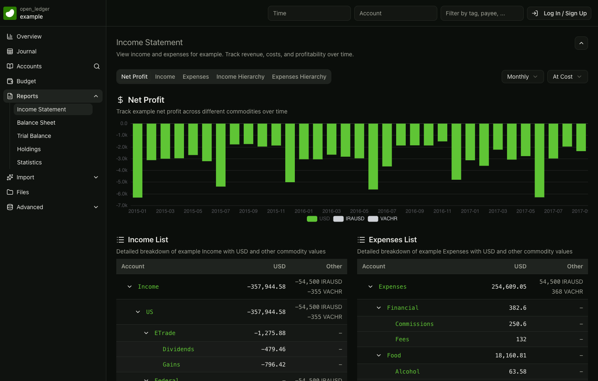
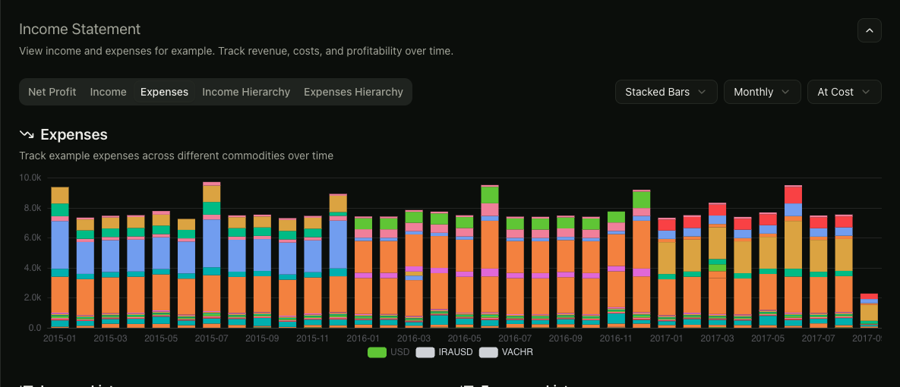
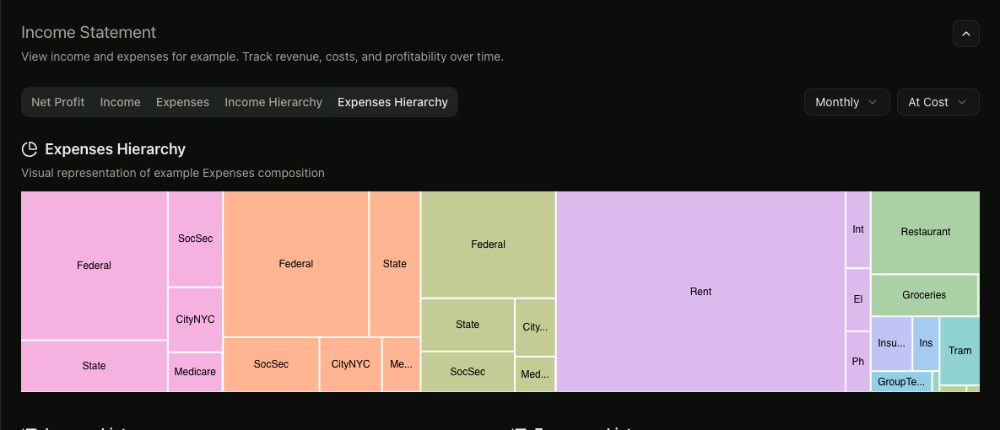
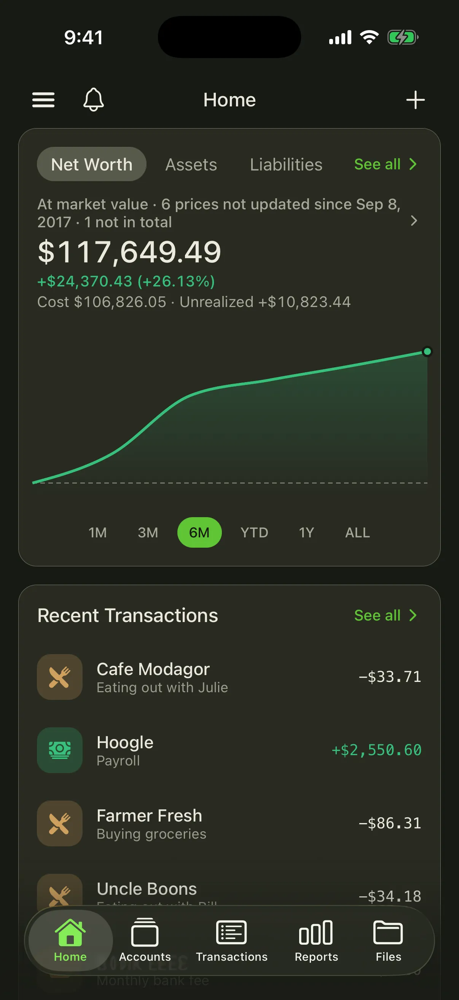
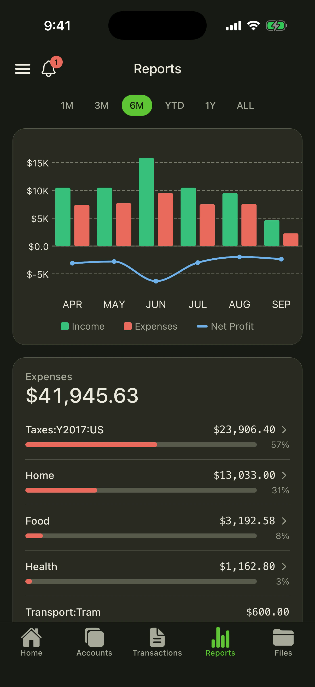
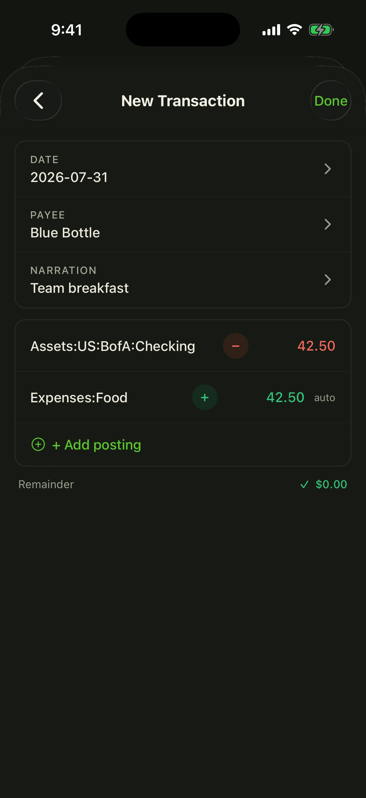

<p align="center">
  <a href="https://beancount.io/?utm_source=github.com&utm_medium=readme&utm_campaign=oss">
    
  </a>
</p>

<h1 align="center">Beancount.io</h1>

<p align="center">
  <strong>Your money in plain text, forever.</strong>
  <br>
  Beautiful reports, a phone app, a terminal CLI, and AI agents that can actually do your books.
</p>

<p align="center">
  <sub>No lock-in. No database you can't read. Your ledger is a <code>.bean</code> file you own, diff, and back up with Git.</sub>
</p>

<p align="center">
  <a href="https://beancount.io/ledger/open_ledger/example/income-statement?utm_source=github.com&utm_medium=readme&utm_campaign=live-demo"><strong>Live demo</strong></a>
  &nbsp;·&nbsp;
  <a href="#try-it-in-30-seconds"><strong>Quickstart</strong></a>
  &nbsp;·&nbsp;
  <a href="#agents-and-mcp"><strong>Agents</strong></a>
  &nbsp;·&nbsp;
  <a href="#self-host"><strong>Self-host</strong></a>
  &nbsp;·&nbsp;
  <a href="#contributing"><strong>Contribute</strong></a>
</p>

<p align="center">
  <a href="https://github.com/bex-co/beancount-io"></a>
  <a href="./LICENSE"></a>
  <a href="https://pypi.org/project/beancount-io/"></a>
  <a href="https://t.me/beancount"></a>
</p>

<p align="center">
  <a href="https://beancount.io/ledger/open_ledger/example/income-statement">
    
  </a>
</p>

<p align="center">
  <a href="https://beancount.io/ledger/open_ledger/example/income-statement"></a>
  <a href="https://beancount.io/ledger/open_ledger/example/income-statement"></a>
</p>

<p align="center">
  <sub>Plain-text ledger in, reports you can explore out — <a href="https://beancount.io/ledger/open_ledger/example/income-statement">open the live example</a>, no sign-up.</sub>
</p>

---

## Pick your way in

<table>
  <tr>
    <td width="33%" valign="top">
      <h3>👀 Look first</h3>
      Click through reports on a real example ledger. No account, no install.
      <br><br>
      <a href="https://beancount.io/ledger/open_ledger/example/income-statement"><strong>Open the live demo →</strong></a>
    </td>
    <td width="33%" valign="top">
      <h3>⌨️ Terminal</h3>
      One command installs <code>bea</code>; it provisions its own engine.
      <br><br>
      <a href="#try-it-in-30-seconds"><strong>First transaction in 30s →</strong></a>
    </td>
    <td width="33%" valign="top">
      <h3>🤖 Agent</h3>
      Skills for Claude Code and Codex, plus a remote MCP server.
      <br><br>
      <a href="#agents-and-mcp"><strong>Hand your agent the books →</strong></a>
    </td>
  </tr>
</table>

## Try it in 30 seconds

No install. No empty-ledger setup. Just record your first real transaction:

1. **Sign up** at [beancount.io/sign-up](https://beancount.io/sign-up) — already have an account? [Log in](https://beancount.io/login).
2. **Open your ledger** (create one if prompted — it takes seconds).
3. **Record a transaction** — on the web open your ledger's Journal and add an entry; on mobile tap **Add Transaction**. Try a coffee run: `Expenses:Dining 12.50` paid from `Assets:Checking`.
4. **See it land** — check the journal, then watch the income statement and balance sheet update.

That's the whole idea: double-entry books you can read as plain text, with reports, phone, terminal, and agents on top of the same ledger.

<details>
<summary><strong>Prefer the terminal? Same first transaction from the CLI</strong></summary>

You don't install Beancount yourself — one command installs `bea`, which provisions its engine for you.

```zsh
brew install bex-co/tap/bea      # macOS / Linuxbrew
# or: uv tool install beancount-io   # anywhere with uv + Python 3.12+
```

```zsh
bea --no-input init books --currency USD --date 2026-08-01 \
  --opening-balance "Assets:Checking 1000"
cd books
bea add transaction "Coffee" --date 2026-08-02 \
  --posting "Expenses:Dining 12.50" --posting "Assets:Checking"
bea check && bea report balance-sheet
```

Checking now holds **987.50 USD** — validated, formatted, and readable as plain text.

</details>

**Then:** record two or three real transactions · open the [live demo](https://beancount.io/ledger/open_ledger/example/income-statement) and click through the balance sheet and account trees · automate with the [CLI tutorial](./cli/docs/TUTORIAL.md) or point your coding agent at the [skills](#agents-and-mcp).

**Already keep Beancount books?** Bring them as they are: `bea init --existing` reads your ledger, writes an `AGENTS.md` that tells your coding agent its root, includes and plugins, and changes no ledger file. See [bring an existing ledger](./docs/skills/existing-ledger.md).

## Who this is for

<table>
  <tr>
    <td width="33%" valign="top"><strong>Plain-text purists</strong><br>Double-entry accounting in files that outlive any app, work with Git, and open in any editor.</td>
    <td width="33%" valign="top"><strong>Developers</strong><br>Script, query, and build on your finances from Python and the terminal instead of exporting CSVs from a SaaS.</td>
    <td width="33%" valign="top"><strong>Agent users</strong><br>Have Claude Code, Codex, or another coding agent import statements, reconcile accounts, and close the month — every write checked and confirm-gated.</td>
  </tr>
</table>

## Every surface, one ledger

| You want to… | Use | Start |
| --- | --- | --- |
| Work from the terminal or scripts | `bea` CLI and Python library | [CLI tutorial](./cli/docs/TUTORIAL.md) · [reference](./cli/docs/USAGE.md) |
| See polished reports in a browser | Web dashboard | [Live demo](https://beancount.io/ledger/open_ledger/example/income-statement) · [`dashboard/`](./dashboard) |
| Track money on the go | iOS & Android apps | [Mobile apps](#mobile-apps) · [`mobile/`](./mobile) |
| Let an agent do your books | Agent skills and MCP | [Agents and MCP](#agents-and-mcp) |
| Self-host the whole stack | Backend cluster | [Self-host](#self-host) |

Your ledger stays the same plain-text file across all of them — hosted or local-first, with no hosted service required for CLI and skills workflows.

## Mobile apps

Review your finances, add transactions, scan receipts, and edit ledger files from the native Beancount client. The same open ledger stays available from the web, terminal, Python, and agent workflows.

<p align="center">
  <a href="./mobile/README.md"></a>
  <a href="./mobile/README.md"></a>
  <a href="./mobile/README.md"></a>
</p>

<p align="center">
  <a href="https://apps.apple.com/us/app/beancount/id1527950512"></a>
  &nbsp;
  <a href="https://play.google.com/store/apps/details?id=io.beancount.android"></a>
</p>

<p align="center"><sub><a href="./mobile/README.md">Explore the mobile product tour</a> or run the Expo app locally.</sub></p>

## Agents and MCP

Beancount.io is built for the agent era: your ledger is text an agent can read, and every write is validated and reversible.

- **Coding-agent skills (local ledger)** — sixteen `beancount-*` workflows for Claude Code and Codex: scaffold a ledger, record everyday entries, payroll runs, investment trades and property events, import bank and payment-processor exports without duplicates, reconcile against statements, migrate from Mint/Monarch/QuickBooks, query finances in plain language (including profit by client or project), explain balance-sheet movements, prepare supported accrual drafts, track invoices and bills with the payments against them, and run a confirm-gated month-end close. [Install the skills](./docs/skills/installation.md) ([native Windows](./docs/skills/installation.md#windows-powershell): Windows PowerShell 5.1) → [ask your first question](./docs/skills/first-query.md) → [first-month guide](./docs/skills/first-month.md) → [migration guide](./docs/skills/migration.md); already in Beancount? [bring an existing ledger](./docs/skills/existing-ledger.md). [Unified suite distribution](./docs/skills/suite-distribution.md) and [OpenClaw/Hermes installation](./docs/skills/installation.md#openclaw-and-hermes-agent) record the current publication and host compatibility limits.
- **MCP server** — point any MCP client at a deployment to query and edit a ledger from an agent. Also listed on the official [MCP Registry](https://registry.modelcontextprotocol.io) as `io.beancount/beancount` (OAuth sign-in).

<details>
<summary><strong>MCP connection details</strong></summary>

```json
{
  "mcpServers": {
    "beancount": {
      "type": "http",
      "url": "https://your-deployment/api-gateway/mcp",
      "headers": { "Authorization": "Bearer [REDACTED]" }
    }
  }
}
```

Tools cover BQL queries, file reads and edits, entry and receipt insertion, account renames, moving entries between files, statement parsing, bank import, and more. URI-addressed resources and accounting prompts support spending reports, month-end close, reconciliation and import categorization — e.g. `/mcp__beancount__close-month` in Claude Code. Use `tools/list`, `resources/templates/list`, and `prompts/list` against your deployment for its current catalog. File edits, directive appends, and bank imports preview with `dry_run`, every call re-authorizes, and failures return a machine code plus the next call to make. Per-host notes for Claude, Claude Code, ChatGPT, Cursor, Copilot, OpenClaw, and Hermes Agent: [MCP docs](./backend-cluster/backend-v2/docs/mcp.md); contract: [ADR 0007](./docs/adrs/ADR007-backend-v2-mcp-surface.md).

</details>

## How it compares

| | Beancount.io | Plain Beancount + Fava | Spreadsheet / SaaS finance app |
| --- | --- | --- | --- |
| Your data | Plain-text `.bean` files you own | Plain-text `.bean` files you own | Locked in a database / their cloud |
| Reports | Web, mobile, CLI, and Python reports | Web reports (Fava) | Built-in, but not programmable |
| On your phone | Native iOS & Android apps | Browser only | Native app, tied to the service |
| AI agents | CLI, skills, and MCP built in | Do it yourself | No agent access |
| Self-host | Yes — hosted, local-only, or your server | Yes, manual | No |
| Cost / license | Free, MIT | Free, open source | Subscription |

Beancount.io stands on [Beancount](https://beancount.github.io/docs/) and Fava rather than replacing them — existing ledgers keep working. Full credits: [ACKNOWLEDGEMENTS.md](./ACKNOWLEDGEMENTS.md).

## Self-host

Hosted, local-only, or your own infrastructure — same ledger either way.

<table>
  <tr>
    <td width="50%" valign="top">
      <strong>bex PaaS — one click</strong><br>
      Provisions Postgres, Gitea on a persistent disk, the API, and the dashboard from the root Blueprint. First build can take 20–40 minutes; see <a href="./deploy/bex/README.md">deploy/bex</a>.
      <br><br>
      <a href="https://dashboard.bex.co/deploy?repo=https://github.com/bex-co/beancount-io&path=bex.yaml"></a>
    </td>
    <td width="50%" valign="top">
      <strong>Your own server or laptop</strong><br>
      <a href="./deploy/docker"><code>deploy/docker/</code></a> — persistent single-server install with automatic TLS.<br>
      <a href="./deploy/docker-mac"><code>deploy/docker-mac/</code></a> — the full stack locally on macOS.
    </td>
  </tr>
</table>

## FAQ

<details>
<summary><strong>Is my financial data private?</strong></summary>

Yes. Your ledger is a plain-text file. Local CLI and skills workflows never require the hosted service; if you self-host, everything runs on your server. You choose where the file lives.

</details>

<details>
<summary><strong>How is this different from plain Beancount or Fava?</strong></summary>

Beancount.io builds on both (Fava ships inside the CLI). It adds native mobile apps, a one-install CLI, hosted or self-hosted collaboration, and first-class agent workflows — while your `.bean` files remain standard Beancount that Fava and other tools can still read.

</details>

<details>
<summary><strong>Can I migrate from Mint, Monarch, or QuickBooks?</strong></summary>

Yes — the [migration guide](./docs/skills/migration.md) converts an export and keeps importing without duplicating transfers.

</details>

<details>
<summary><strong>Do I have to self-host?</strong></summary>

No. Use the hosted service at [beancount.io](https://beancount.io/), run everything locally with the CLI, or self-host on one server with [`deploy/docker/`](./deploy/docker). Same ledger either way.

</details>

## Run from source

There is no root package to install; each package owns its dependencies and checks.

<details>
<summary><strong>Web dashboard, mobile app, and CLI from this checkout</strong></summary>

Web dashboard (Node.js 22, Yarn 4 via Corepack, plus a Beancount.io API endpoint):

```zsh
cd dashboard && corepack enable && yarn install --immutable
cp .env.example .env && yarn dev   # http://localhost:5173
```

See the [dashboard setup guide](./dashboard/README.md). Containers instead? [`deploy/docker-mac/`](./deploy/docker-mac) runs the full stack locally on macOS; [`deploy/docker/`](./deploy/docker) is the persistent single-server install.

Mobile app (Node.js 20.19.4+, Yarn Classic):

```zsh
cd mobile && yarn install && yarn start
```

See the [mobile development guide](./mobile/README.md).

CLI from this checkout:

```zsh
cd cli && uv sync --all-groups && uv run bea --help
```

`bea upgrade` updates through whichever package manager installed it. Full command tree, automation contract, and exit codes: [CLI reference](./cli/docs/USAGE.md) and generated [command reference](./cli/docs/REFERENCE.md).

</details>

<details>
<summary><strong>Quality bar (run before opening a PR)</strong></summary>

| Package | Check |
| --- | --- |
| Dashboard | `cd dashboard && yarn format:check && yarn lint && yarn test && yarn build` |
| Mobile | `cd mobile && yarn format:check && yarn lint && yarn typecheck && yarn test:unit` |
| CLI | `cd cli && make check-all` |
| Skills | `python3 scripts/skills/ci-check.py` |

Every active package has path-filtered CI, and a repository-wide secret scan gates every push and pull request. Run `scripts/lint-deadcode.sh` from the repository root to check for unused files and symbols (`scripts/fix-deadcode.sh` applies removals; review the diff and rerun full checks).

</details>

<details>
<summary><strong>For contributors: what's in this monorepo</strong></summary>

| Package | What it is |
| --- | --- |
| [`dashboard/`](./dashboard) | Active web client: ledgers, journal, reports, Monaco editor, imports, collaboration, AI assistant (React 19 + TanStack Start + Apollo) |
| [`mobile/`](./mobile) | Active iOS & Android client (Expo + React Native + Apollo) |
| [`cli/`](./cli) | Active `bea` CLI (including a local read-only MCP server, `bea mcp`) and Python tooling ([releases](https://github.com/bex-co/beancount-io/releases?q=bea)) |
| [`skills/`](./skills) | One Beancount.io ledger suite with sixteen `beancount-*` workflows; install the versioned `beancount-io` plugin or the complete source collection. |
| [`backend-cluster/`](./backend-cluster) | Active backend: GraphQL/REST gateway, ledger service, IDL, and agent sandbox |

The dashboard and mobile app are clients for the Beancount.io API served by `backend-cluster/` — hosted, or self-run. Skills have two audiences: Beancount users get [`skills/`](./skills/README.md); repository contributors get [`.agents/skills/`](./.agents/skills) (see [`.agents/AGENTS.md`](./.agents/AGENTS.md)). The root `.claude/skills` links to `.agents/skills` so Claude Code and Codex share the internal workflows.

</details>

## Contributing

Contributions are welcome across product UI, accounting workflows, accessibility, translations, tests, Python tooling, and agent skills. Start with the [contributing guide](./CONTRIBUTING.md), browse [open issues](https://github.com/bex-co/beancount-io/issues) and the public [adoption roadmap](./.pm/README.md), and keep changes focused on one package when possible.

Read our [code of conduct](./CODE_OF_CONDUCT.md) before participating. Report vulnerabilities privately through the [security policy](./SECURITY.md).

If Beancount.io is the kind of open, programmable finance software you want to see more of, [star the repository](https://github.com/bex-co/beancount-io) and help more developers find it.

## Community

- Website: [beancount.io](https://beancount.io/)
- Chat: [Telegram](https://t.me/beancount)
- Mobile: [App Store](https://apps.apple.com/us/app/beancount/id1527950512) · [Google Play](https://play.google.com/store/apps/details?id=io.beancount.android)
- Issues: [github.com/bex-co/beancount-io/issues](https://github.com/bex-co/beancount-io/issues)

## Acknowledgements

Beancount.io stands on [Beancount](https://github.com/beancount/beancount) and [Fava](https://github.com/beancount/fava) — the vendored `fava` package inside `cli/src/fava` ships as bundled subprocess resources in the single `beancount-io` distribution, and the rest of the plain-text accounting stack ([beanquery](https://github.com/beancount/beanquery), [beangulp](https://github.com/beancount/beangulp), [rustledger](https://github.com/rustledger/rustledger)) is used as unmodified upstream dependencies. Full credits and license compliance: [ACKNOWLEDGEMENTS.md](./ACKNOWLEDGEMENTS.md).

## License

[MIT](./LICENSE) © Beancount.io applies by default. The customer skill suite under [`skills/`](./skills/) uses [MIT No Attribution (MIT-0)](./skills/LICENSE), including its instructions, references, and fixtures. Upstream projects remain under their own licenses.

