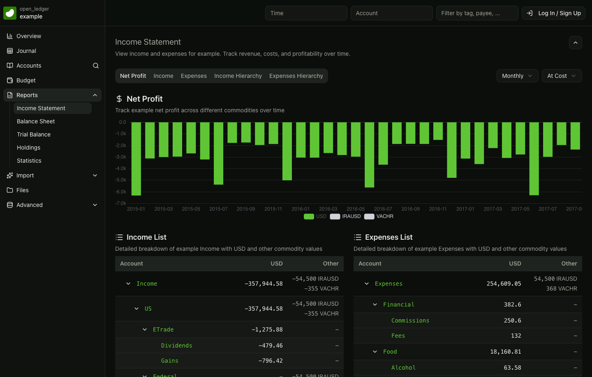
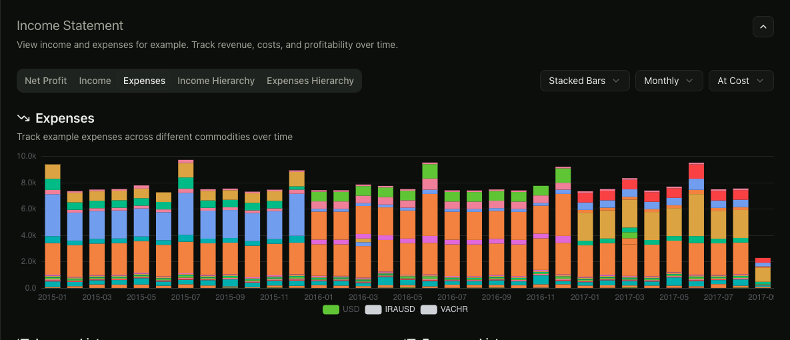
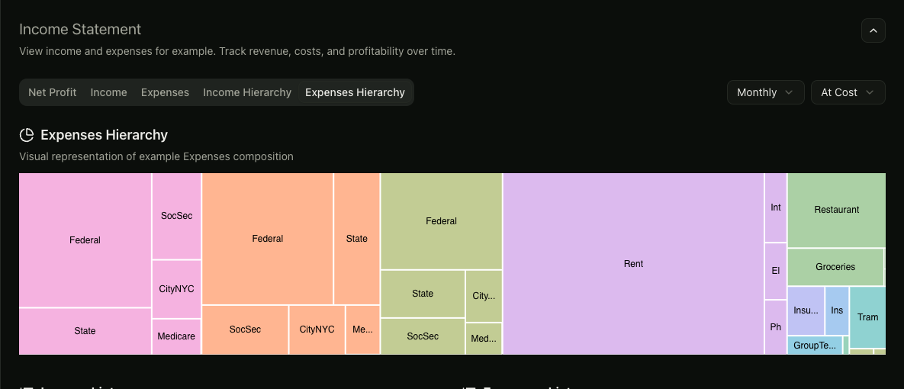
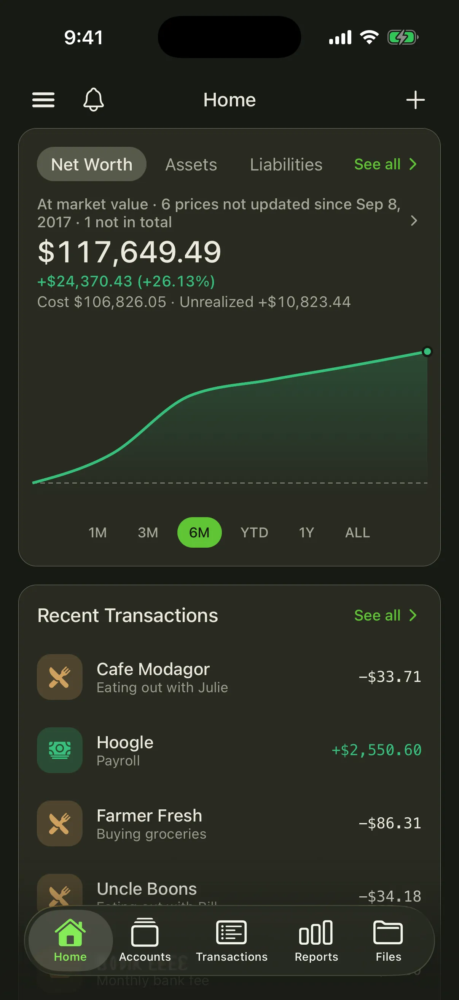
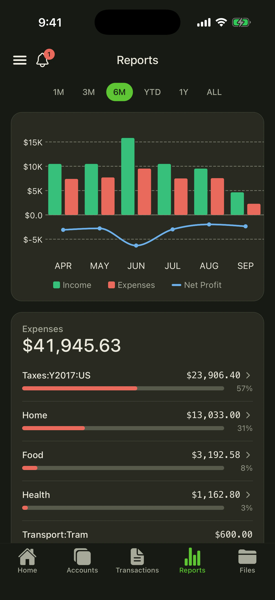
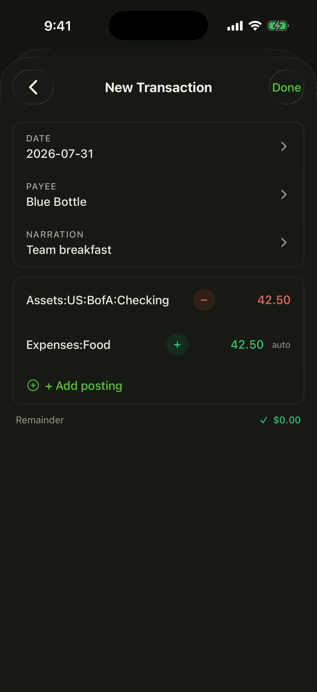

<p align="center">
  <a href="https://beancount.io/?utm_source=github.com&utm_medium=readme&utm_campaign=oss">
    
  </a>
</p>

<h1 align="center">Beancount.io</h1>

<p align="center">
  <strong>Your money in plain text forever — beautiful reports, a phone app, a terminal CLI, and AI agents that can actually do your books.</strong>
  <br>
  No lock-in. No database you can't read. Your ledger is a <code>.bean</code> text file you own, diff, and back up with Git — Beancount.io just makes it effortless to use everywhere.
</p>

<p align="center">
  <a href="https://beancount.io/ledger/open_ledger/example/income-statement?utm_source=github.com&utm_medium=readme&utm_campaign=live-demo"><strong>▶ Try the live demo — no sign-up</strong></a>
  ·
  <a href="#try-it-in-30-seconds">Sign up and record a transaction</a>
  ·
  <a href="https://github.com/bex-co/beancount-io"><strong>⭐ Star to support open finance</strong></a>
</p>

<p align="center">
  <a href="https://github.com/bex-co/beancount-io"></a>
  <a href="./LICENSE"></a>
</p>

<p align="center">
  <a href="https://beancount.io/ledger/open_ledger/example/income-statement">
    
  </a>
</p>

<p align="center">
  <sub>Turn a plain-text ledger into reports you can explore — <a href="https://beancount.io/ledger/open_ledger/example/income-statement">open the live example</a>.</sub>
</p>

<p align="center">
  <a href="https://beancount.io/ledger/open_ledger/example/income-statement"></a>
  <a href="https://beancount.io/ledger/open_ledger/example/income-statement"></a>
</p>

## Try it in 30 seconds

No install. No empty-ledger setup. Just record your first real transaction:

1. **Sign up** at [beancount.io/sign-up](https://beancount.io/sign-up) — already have an account? [Log in](https://beancount.io/login).
2. **Open your ledger** (create one if prompted — it takes seconds).
3. **Record a transaction** — on the web open your ledger's Journal and add an entry; on mobile tap **Add Transaction**. Try a coffee run: `Expenses:Dining 12.50` paid from `Assets:Checking`.
4. **See it land** — check the journal, then watch the income statement and balance sheet update.

That's the whole idea: double-entry books you can read as plain text, with reports, phone, terminal, and agents on top of the same ledger.

> If Beancount.io is the kind of open, programmable finance you want more of, [⭐ star this repo](https://github.com/bex-co/beancount-io) — it genuinely helps other developers find it.

<details>
<summary><strong>Prefer the terminal? Same first transaction from the CLI</strong></summary>

You don't install Beancount yourself — one command installs `bea`, which provisions its engine for you.

```zsh
brew install bex-co/tap/bea      # macOS / Linuxbrew
# or: uv tool install beancount-io   # anywhere with uv + Python 3.12+
```

```zsh
bea --no-input init books --currency USD --date 2026-08-01 \
  --opening-balance "Assets:Checking 1000"
cd books
bea add transaction "Coffee" --date 2026-08-02 \
  --posting "Expenses:Dining 12.50" --posting "Assets:Checking"
bea check && bea report balance-sheet
```

Checking now holds **987.50 USD** — validated, formatted, and readable as plain text.

</details>

### Your first five minutes

- [ ] Sign up, open your ledger, and record the transaction above — on the web or in the [mobile app](#mobile-apps).
- [ ] Open the [live demo](https://beancount.io/ledger/open_ledger/example/income-statement) and click through the income statement, balance sheet, and account trees.
- [ ] Add two or three real transactions, then check the updated reports.
- [ ] Optional: automate with the [CLI tutorial](./cli/docs/TUTORIAL.md) or point your coding agent at the [skills](#agents-and-mcp).

## Who this is for

- **Plain-text purists** — you want double-entry accounting in files that outlive any app, work with Git, and open in any editor.
- **Developers** — you want to script, query, and build on your finances from Python and the terminal instead of exporting CSVs from a SaaS.
- **Agent users** — you want Claude Code, Codex, or another coding agent to import statements, reconcile accounts, and close the month, with every write checked and confirm-gated.

Not sure yet? The [live demo](https://beancount.io/ledger/open_ledger/example/income-statement) needs no account — decide there.

## How it compares

| | Beancount.io | Plain Beancount + Fava | Spreadsheet / SaaS finance app |
| --- | --- | --- | --- |
| Your data | Plain-text `.bean` files you own | Plain-text `.bean` files you own | Locked in a database / their cloud |
| Reports | Web, mobile, CLI, and Python reports | Web reports (Fava) | Built-in, but not programmable |
| On your phone | Native iOS & Android apps | Browser only | Native app, tied to the service |
| AI agents | CLI, skills, and MCP built in | Do it yourself | No agent access |
| Self-host | Yes — hosted, local-only, or your server | Yes, manual | No |
| Cost / license | Free, MIT | Free, open source | Subscription |

Beancount.io stands on [Beancount](https://beancount.github.io/docs/) and Fava rather than replacing them — existing ledgers keep working. Full credits: [ACKNOWLEDGEMENTS.md](./ACKNOWLEDGEMENTS.md).

## Mobile apps

Review your finances, add transactions, scan receipts, and edit ledger files from the native Beancount client. The same open ledger remains available from the web, terminal, Python, and agent workflows.

<p align="center">
  <a href="./mobile/README.md"></a>
  <a href="./mobile/README.md"></a>
  <a href="./mobile/README.md"></a>
</p>

<p align="center">
  <a href="https://apps.apple.com/us/app/beancount/id1527950512"></a>
  &nbsp;
  <a href="https://play.google.com/store/apps/details?id=io.beancount.android"></a>
</p>

<p align="center"><sub><a href="./mobile/README.md">Explore the mobile product tour</a> or run the Expo app locally.</sub></p>

## Every surface, one ledger

| You want to… | Use | Start |
| --- | --- | --- |
| Work from the terminal or scripts | `bea` CLI and Python library | [CLI tutorial](./cli/docs/TUTORIAL.md) · [reference](./cli/docs/USAGE.md) |
| See polished reports in a browser | Web dashboard | [Live demo](https://beancount.io/ledger/open_ledger/example/income-statement) · [`dashboard/`](./dashboard) |
| Track money on the go | iOS & Android apps | [Mobile apps](#mobile-apps) · [`mobile/`](./mobile) |
| Let an agent do your books | Agent skills and MCP | [Agents and MCP](#agents-and-mcp) |
| Self-host the whole stack | Backend cluster | [`deploy/docker/`](./deploy/docker) (one server) · [`deploy/docker-mac/`](./deploy/docker-mac) (local) |

Your ledger stays the same plain-text file across all of them — hosted or local-first, with no hosted service required for CLI and skills workflows.

<details>
<summary><strong>For contributors: what's in this monorepo</strong></summary>

| Package | What it is |
| --- | --- |
| [`dashboard/`](./dashboard) | Active web client: ledgers, journal, reports, Monaco editor, imports, collaboration, AI assistant (React 19 + TanStack Start + Apollo) |
| [`mobile/`](./mobile) | Active iOS & Android client (Expo + React Native + Apollo) |
| [`cli/`](./cli) | Active `bea` CLI and Python tooling ([releases](https://github.com/bex-co/beancount-io/releases?q=bea)) |
| [`skills/`](./skills) | Active agent ledger skills (the ten `beancount-*` workflows; also installable as the `beancount-io` plugin) |
| [`backend-cluster/`](./backend-cluster) | Active backend: GraphQL/REST gateway, ledger service, IDL, and agent sandbox |

The dashboard and mobile app are clients for the Beancount.io API served by `backend-cluster/` — hosted, or self-run. Skills have two audiences: Beancount users get [`skills/`](./skills/README.md); repository contributors get [`.agents/skills/`](./.agents/skills) (see [`.agents/AGENTS.md`](./.agents/AGENTS.md)). The root `.claude/skills` links to `.agents/skills` so Claude Code and Codex share the internal workflows.

</details>

## Agents and MCP

Beancount.io is built for the agent era: your ledger is text an agent can read, and every write is validated and reversible.

- **Coding-agent skills (local ledger)** — ten `beancount-*` workflows for Claude Code and Codex: scaffold a ledger, record everyday entries and investment trades with correct lots, import bank exports without duplicates, reconcile against statements, migrate from Mint/Monarch/QuickBooks, query finances in plain language, and run a confirm-gated month-end close. [Install the skills](./docs/skills/installation.md) → [ask your first question](./docs/skills/first-query.md) → [first-month guide](./docs/skills/first-month.md) → [migration guide](./docs/skills/migration.md).
- **MCP server** — point any MCP client at a deployment to query and edit a ledger from an agent. Also listed on the official [MCP Registry](https://registry.modelcontextprotocol.io) as `io.beancount/beancount` (OAuth sign-in).

<details>
<summary><strong>MCP connection details</strong></summary>

```json
{
  "mcpServers": {
    "beancount": {
      "type": "http",
      "url": "https://your-deployment/api-gateway/mcp",
      "headers": { "Authorization": "Bearer [REDACTED]" }
    }
  }
}
```

Forty-three tools, one per operation (BQL queries, file reads and edits, entry and receipt insertion, statement parsing, bank import, and more), 64 URI-addressed resources, and four prompts (spending report, month-end close, reconciliation, import categorization — e.g. `/mcp__beancount__close-month` in Claude Code). File edits, directive appends, and bank imports preview with `dry_run`, every call re-authorizes, and failures return a machine code plus the next call to make. Per-host notes for Claude, Claude Code, ChatGPT, Cursor, Copilot, OpenClaw, and Hermes Agent: [MCP docs](./backend-cluster/backend-v2/docs/mcp.md); contract: [ADR 0007](./docs/adrs/ADR007-backend-v2-mcp-surface.md).

</details>

## FAQ

<details>
<summary><strong>Is my financial data private?</strong></summary>

Yes. Your ledger is a plain-text file. Local CLI and skills workflows never require the hosted service; if you self-host, everything runs on your server. You choose where the file lives.

</details>

<details>
<summary><strong>How is this different from plain Beancount or Fava?</strong></summary>

Beancount.io builds on both (Fava ships inside the CLI). It adds native mobile apps, a one-install CLI, hosted or self-hosted collaboration, and first-class agent workflows — while your `.bean` files remain standard Beancount that Fava and other tools can still read.

</details>

<details>
<summary><strong>Can I migrate from Mint, Monarch, or QuickBooks?</strong></summary>

Yes — the [migration guide](./docs/skills/migration.md) converts an export and keeps importing without duplicating transfers.

</details>

<details>
<summary><strong>Do I have to self-host?</strong></summary>

No. Use the hosted service at [beancount.io](https://beancount.io/), run everything locally with the CLI, or self-host on one server with [`deploy/docker/`](./deploy/docker). Same ledger either way.

</details>

## Run from source

There is no root package to install; each package owns its dependencies and checks.

<details>
<summary><strong>Web dashboard, mobile app, and CLI from this checkout</strong></summary>

Web dashboard (Node.js 22, Yarn 4 via Corepack, plus a Beancount.io API endpoint):

```zsh
cd dashboard && corepack enable && yarn install --immutable
cp .env.example .env && yarn dev   # http://localhost:5173
```

See the [dashboard setup guide](./dashboard/README.md). Containers instead? [`deploy/docker-mac/`](./deploy/docker-mac) runs the full stack locally on macOS; [`deploy/docker/`](./deploy/docker) is the persistent single-server install.

Mobile app (Node.js 20.19.4+, Yarn Classic):

```zsh
cd mobile && yarn install && yarn start
```

See the [mobile development guide](./mobile/README.md).

CLI from this checkout:

```zsh
cd cli && uv sync --all-groups && uv run bea --help
```

`bea upgrade` updates through whichever package manager installed it. Full command tree, automation contract, and exit codes: [CLI reference](./cli/docs/USAGE.md) and generated [command reference](./cli/docs/REFERENCE.md).

</details>

<details>
<summary><strong>Quality bar (run before opening a PR)</strong></summary>

| Package | Check |
| --- | --- |
| Dashboard | `cd dashboard && yarn format:check && yarn lint && yarn test && yarn build` |
| Mobile | `cd mobile && yarn format:check && yarn lint && yarn typecheck && yarn test:unit` |
| CLI | `cd cli && make check-all` |
| Skills | `python3 scripts/skills/ci-check.py` |

Every active package has path-filtered CI, and a repository-wide secret scan gates every push and pull request. Run `scripts/lint-deadcode.sh` from the repository root to check for unused files and symbols (`scripts/fix-deadcode.sh` applies removals; review the diff and rerun full checks).

</details>

## Contributing

Contributions are welcome across product UI, accounting workflows, accessibility, translations, tests, Python tooling, and agent skills. Start with the [contributing guide](./CONTRIBUTING.md), browse [open issues](https://github.com/bex-co/beancount-io/issues) and the public [adoption roadmap](./.pm/README.md), and keep changes focused on one package when possible.

If Beancount.io is the kind of open, programmable finance software you want to see more of, [star the repository](https://github.com/bex-co/beancount-io) and help more developers find it.

## Community

- Website: [beancount.io](https://beancount.io/)
- Chat: [Telegram](https://t.me/beancount)
- Mobile: [App Store](https://apps.apple.com/us/app/beancount/id1527950512) · [Google Play](https://play.google.com/store/apps/details?id=io.beancount.android)
- Issues: [github.com/bex-co/beancount-io/issues](https://github.com/bex-co/beancount-io/issues)

## Acknowledgements

Beancount.io stands on [Beancount](https://github.com/beancount/beancount) and [Fava](https://github.com/beancount/fava) — the vendored `fava` package inside `cli/src/fava` ships as bundled subprocess resources in the single `beancount-io` distribution, and the rest of the plain-text accounting stack ([beanquery](https://github.com/beancount/beanquery), [beangulp](https://github.com/beancount/beangulp), [rustledger](https://github.com/rustledger/rustledger)) is used as unmodified upstream dependencies. Full credits and license compliance: [ACKNOWLEDGEMENTS.md](./ACKNOWLEDGEMENTS.md).

## License

[MIT](./LICENSE) © Beancount.io applies by default. The customer skill suite under [`skills/`](./skills/) uses [MIT No Attribution (MIT-0)](./skills/LICENSE), including its instructions, references, and fixtures. Upstream projects remain under their own licenses.

