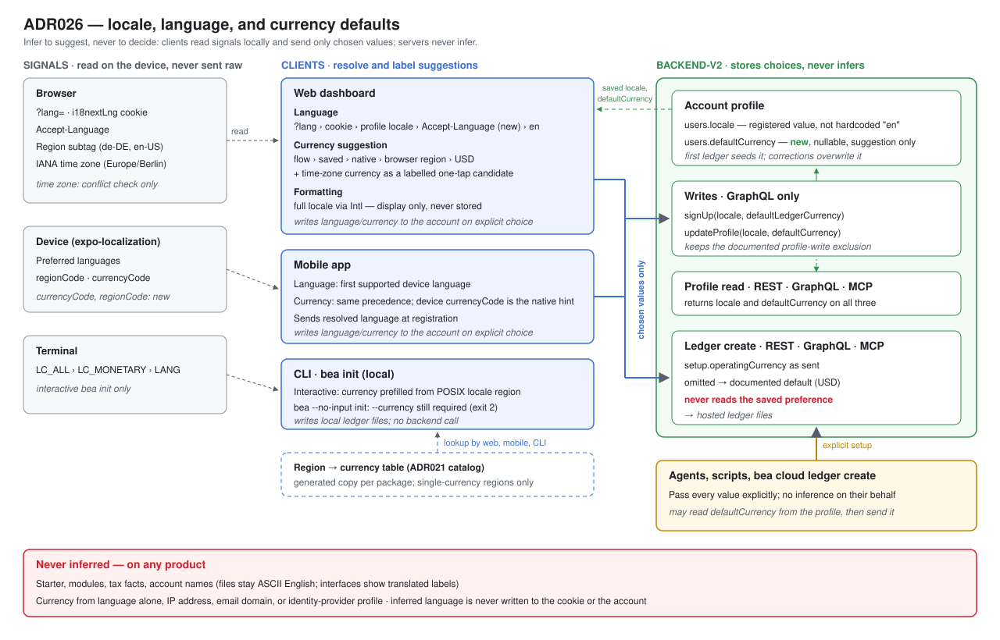
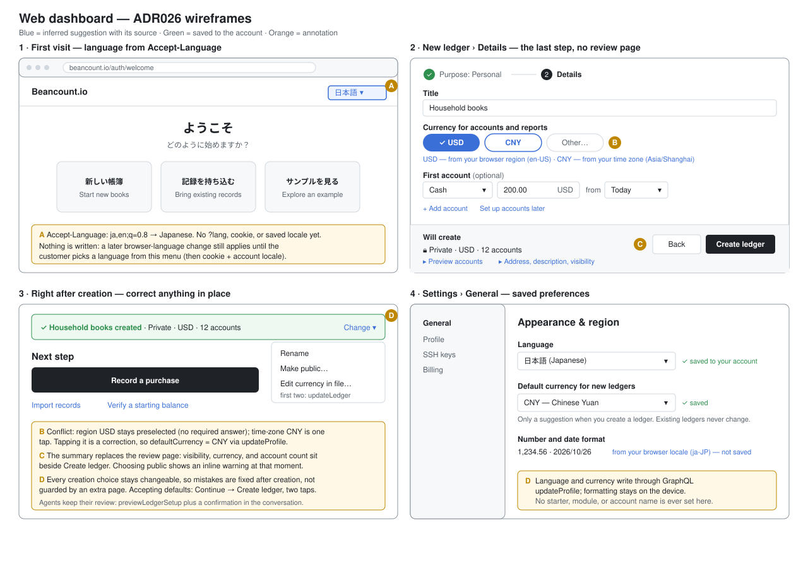
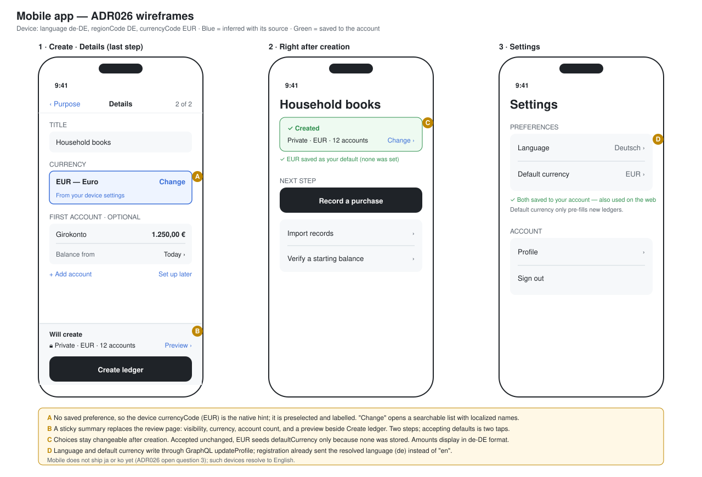
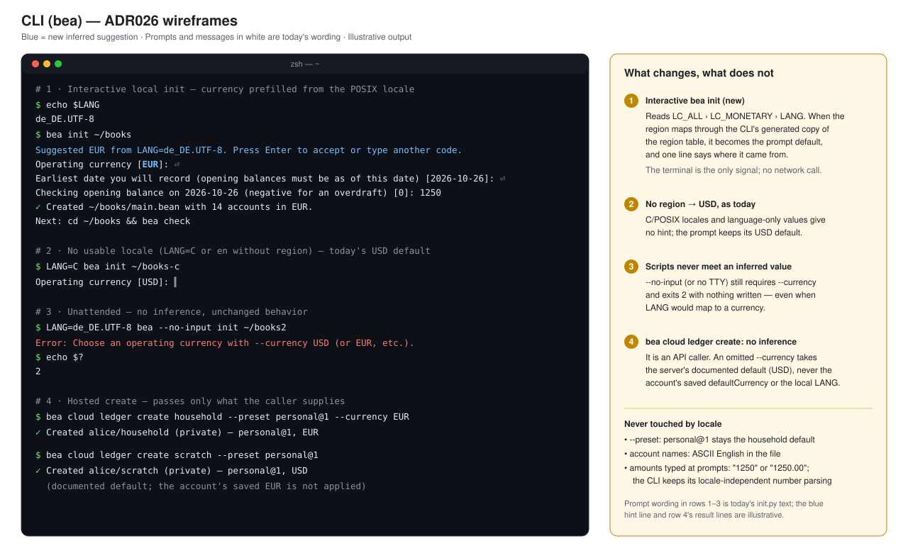
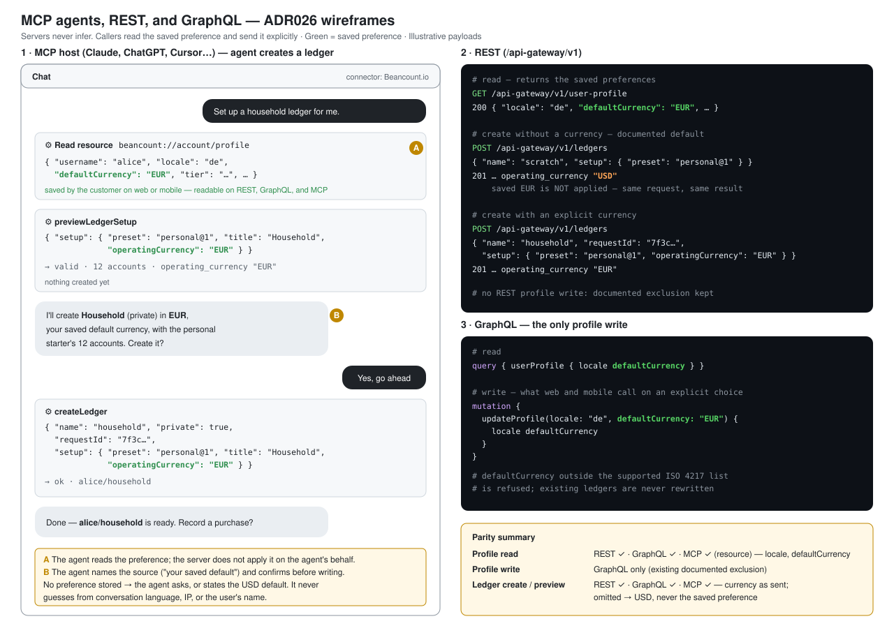

# ADR 0026: Locale, language, and currency defaults — infer to suggest, never to decide

- Status: Proposed
- Date: 2026-10-26
- Owners: Product, dashboard, mobile, backend-v2, CLI
- Baseline: source tree read on 2026-10-26
- Scope: which signals may set the interface language, number and date formatting, and the suggested operating currency of a new ledger; where those choices are saved; and what is never inferred. This record replaces the "Suggestion precedence" paragraph of [ADR021](./ADR021-backend-v2-ledger-creation-experience.md#supported-currencies-and-region-mapping) and settles its [open question 7](./ADR021-backend-v2-ledger-creation-experience.md#open-questions) (saved currency preference). The currency and region tables stay ADR021's. It adds no roadmap items; only `/pm` writes the board.

Affected products. Inference happens only on clients a person is looking at; servers never infer.

| Product | Interface language | Saved `locale` / `defaultCurrency` | Currency suggestion | Phases |
| --- | --- | --- | --- | --- |
| Web dashboard | Adds the `Accept-Language` fallback | Reads and writes: registration `locale`, settings write-through | Precedence, time-zone conflict check, source labels | 1, 2, 3 |
| Mobile app | Unchanged (device languages) | Reads and writes: registration `locale`, settings write-through | Adds the device `currencyCode` and `regionCode` hints | 2, 3 |
| CLI `bea init` | Not applicable | Not applicable | Interactive prompt prefilled from the POSIX locale; unattended unchanged | 4 |
| CLI `bea cloud ledger create` | Not applicable | Not applicable | None: passes only what the caller supplies | — |
| REST, GraphQL, MCP (backend-v2) | Not applicable | Profile reads return `defaultCurrency` on all three; writes stay on GraphQL `updateProfile` | None: an omitted currency takes the documented default, never the saved preference | 2, 3 |

## Decision

Infer only what the customer can see and undo. The more permanent the effect, the more visible the suggestion has to be:

| Setting | Where it lands | Rule |
| --- | --- | --- |
| Interface language | The interface only | Set automatically from the best available signal; saved to the account once the customer chooses one |
| Number and date formatting | Display and input parsing only | Follows the full browser or device locale; never saved and never written to a ledger |
| Operating currency of a new ledger | The ledger's files | Prefilled, labelled with its source, editable, and restated in the summary beside **Create ledger**; never applied silently |
| Starter, modules, tax facts, account names | The ledger's structure | Never inferred from locale, language, region, or any other metadata |

## What exists today

| Area | As built |
| --- | --- |
| Dashboard language | [`detectLanguageOnServer`](../../dashboard/src/i18n/detect-language/server.ts) resolves `?lang=`, then the `i18nextLng` cookie, then `en`. It does not read `Accept-Language`, so a first visit is English whatever the browser asks for. The router [dehydrates](../../dashboard/src/router.tsx) the resolved language for the client. An explicit switch is [saved only in the browser](../../dashboard/src/i18n/funcs.ts), as cookie and localStorage. |
| Mobile language | [`getLocale`](../../mobile/src/translations/index.ts) walks `expo-localization`'s device locales and takes the first supported `languageCode`. It does not read the device's `regionCode` or `currencyCode`. Mobile ships 13 languages; the dashboard also ships `ja` and `ko`. |
| Account locale | `users.locale` is `NOT NULL DEFAULT 'en'` ([schema](../../backend-cluster/backend-v2/src/features/auth/data/user-model/schema.ts)). [`registerUser`](../../backend-cluster/backend-v2/src/features/auth/service/auth-service.ts) hardcodes `"en"`, and `UserModel.updateLocale` has no caller. So every account reads `en`, including the account feed, which [falls back to the profile locale](../../backend-cluster/backend-v2/src/features/gitea/feed/service/feed-service.ts). |
| Profile surfaces | The profile is readable on REST (`GET /api-gateway/v1/user-profile`), GraphQL, and MCP, and includes `locale`. `Mutation.updateProfile` is [GraphQL-only](../../backend-cluster/backend-v2/src/server/api/op-class.ts) (`accountProfile`, `notAgentShaped`). That is one of the documented profile-update exclusions in [api-parity.md](../../backend-cluster/backend-v2/docs/api-parity.md). |
| Currency | ADR021 defines the suggestion. No account-level currency preference exists. `bea init` prompts with `USD` and, unattended, refuses a missing `--currency` with exit 2. |

## Experience by product

Wireframes illustrate the decisions below; they are not visual designs, and payloads and result lines are illustrative. Blue marks an inferred suggestion with its source, green a value saved to the account.

**Web dashboard.** First visit in the browser's language, the two-step creation flow with the conflict candidate and the summary beside **Create ledger**, and saved preferences in settings.

**Mobile app.** The device currency as the native hint on the details step with its sticky summary, and the saved preferences shared with the web.

**CLI.** The interactive `bea init` prefill from the POSIX locale, the unchanged USD and unattended paths, and hosted create without inference.

**MCP agents, REST, and GraphQL.** An agent reads the saved preference and sends it explicitly; an omitted currency stays the documented default; profile writes stay on GraphQL.

## Interface language

Resolution order, first match wins. Every candidate is matched to a supported language by primary subtag:

1. `?lang=` in the URL.
2. The `i18nextLng` cookie, which only an explicit choice writes.
3. The signed-in account's saved `locale`, once one has been saved (see below).
4. **New:** `Accept-Language` on the server, taking the highest-weighted supported entry. The router already hands the server's result to the client, so client detection needs no separate browser read.
5. `en`.

An inferred language is never written to the cookie or the account. A later change of browser language therefore still applies until the customer picks one.

Saving the choice:

- Registration accepts an optional `locale` validated against the supported list and stores it instead of `"en"`. The dashboard sends the language the customer registered in. Mobile sends its resolved language.
- Changing language in settings while signed in also writes `locale` through `Mutation.updateProfile`, alongside the existing cookie and localStorage write. Mobile writes it the same way when the customer changes language. Accounts created before this change keep their stored `en` until the customer switches. A migration cannot tell a real choice from the default.

## Number and date formatting

Formatting uses the full browser or device locale (for example `de-DE`, `en-GB`, `pt-BR`) through `Intl`, independently of the interface language. A German-speaking customer in Switzerland sees `de` text with `de-CH` numbers. Amount inputs accept that locale's unambiguous format and show the normalized value before saving, as ADR021 requires. Ledger files always use Beancount syntax. The formatting locale is never sent to the server or stored.

## Saved currency preference

Settles ADR021 open question 7: add one.

- New nullable account field `defaultCurrency`, validated against ADR021's supported operating currencies. It is readable wherever the profile is: REST, GraphQL, and MCP.
- **Written** when the customer changes a suggested currency in a creation flow, when they set it in settings, or from the signup `defaultLedgerCurrency` (ADR021). A suggestion accepted unchanged is saved only when no preference is stored, so the first ledger seeds it and later defaults never overwrite a deliberate choice.
- **Writes** go through `Mutation.updateProfile` and keep that operation's documented REST and MCP exclusion. This record does not widen account-profile write policy. An agent reads the preference from the profile and passes it explicitly.
- It is a suggestion, never a constraint. It does not convert amounts, restrict other currencies, or change existing ledgers.

## Currency suggestion

Clients resolve the suggestion once, before the details step. A correction is preserved across re-renders, starter switches, validation errors, back navigation, and OTP retries, as ADR021 requires.

1. An explicit selection in the active flow.
2. The account's saved `defaultCurrency`.
3. A supported native currency hint (`expo-localization` `currencyCode`).
4. The currency of an explicit browser or device region, through ADR021's region table.
5. `USD`.

**Conflict check (new).** The client also maps the browser's IANA time zone to its country, then through the same region table. When step 4 applies and the time zone maps to a different currency, the step-4 currency stays preselected. The time-zone currency is shown beside it as a one-tap candidate, for example **USD** (preselected) · **CNY** · **Other…**, with the source in words ("from your browser region" / "from your time zone"). This is aimed at the common case of an `en-US` system locale outside the United States. Preselection is kept so that accepting every default still reaches a valid ledger without a required answer.

When no step-4 region exists (language without region, such as `en`), a time-zone currency may appear as a candidate beside the `USD` fallback but is never preselected. Time zone alone never selects a currency.

Every suggestion from steps 2–4 is labelled with its source, and the summary beside **Create ledger** restates the currency.

## Never inferred

- **The starter, its modules, and any tax fact.** A purpose depends on the customer's circumstances, not their geography. PRFAQ001 question 2: "Do not infer financial circumstances from age, nationality, language, or job title." Region-aware help, such as suggesting a local tax-year start as a balance's **from** date, is a later, explicit choice and never a default.
- **Account names.** Generated account names stay in the catalog's ASCII English so files work with upstream tools, the customer skills, and importers. Interfaces show translated labels; the file is never localized.
- **Currency from language alone, IP address, email domain, or identity-provider profile.** Language maps to many currencies (`zh`, `es`, `en`, `ar`). IP misleads on VPNs, travel, and for expatriates, who are a core multi-currency audience, and self-hosted deployments do not have it. Email and identity-provider locales are weak and read as surveillance.

## Machine callers and the CLI

- **REST, GraphQL, and MCP never infer.** An omitted `setup.operatingCurrency` takes ADR021's documented default, never the account's saved preference. An API result must not depend on hidden account state. `Accept-Language` on API requests affects only already-localized messages, never ledger content.
- **`bea init`, interactive:** the currency prompt prefills from the POSIX locale (`LC_ALL`, then `LC_MONETARY`, then `LANG`) when its region maps through the CLI's generated copy of the region table. Otherwise it prefills `USD`. **Unattended:** unchanged. A missing `--currency` is still exit 2, so scripts never meet an inferred value.
- **`bea cloud ledger create`:** no inference. It passes only what the caller supplies.

## Privacy and measurement

Inference runs on the client. The server receives only the resulting values: the request's own `Accept-Language`, a chosen language, a chosen currency. No raw time zone, device locale, or region is stored.

Analytics record, per hosted creation: the source of the currency suggestion (`flow`, `saved`, `native`, `region`, `fallback`), whether a time-zone candidate was shown, and whether the customer changed the currency. They do not record the currency values, titles, or account names.

Decision thresholds:
- The correction rate per source is the accuracy measure.
- If customers shown a conflicting candidate pick it more often than they keep the preselection, revisit whether time zone should outrank browser region (open question 1).
- An auto-detected interface language that is then manually switched counts as a language-detection miss.

## Phasing

1. **Language fallback.** `Accept-Language` step on the dashboard server. Small, independent, and visible on the first visit.
2. **Saved locale.** Registration `locale`, settings write-through on dashboard and mobile, and profile-locale step for signed-in sessions.
3. **Currency preference and suggestion.** `defaultCurrency` field, profile reads on three surfaces, the conflict check, and source labels in ADR021's staged flow (w3/m54). It lands with or before that flow so the flow does not hard-code ADR021's older order.
4. **CLI prompt hint.** POSIX-locale prefill in interactive `bea init`.

## Open questions

1. **Time zone or browser region first?** This record keeps browser region preselected and offers the time-zone currency as a candidate. Measured choices may justify swapping them.
2. **Chinese script variants.** `zh-TW` and `zh-HK` resolve to the single shipped `zh`. Does it fit them, or is a `zh-Hant` locale needed? Out of scope here; record the result of the language-detection measurement.
3. **Mobile `ja` and `ko`.** The dashboard ships them and mobile does not. A native customer in Japan resolves to English.

## Risks

- **Wrong preselection still happens.** Labels and the summary restatement make it visible, and a one-tap candidate makes it cheap to fix. Measurement decides whether the order changes.
- **Hidden state.** A saved preference that silently changed API results would surprise agents and scripts, so machine callers ignore it by design.
- **Stale `en` locales.** Existing accounts keep the default until their owner chooses. Features that read the profile locale, like the account feed, must keep treating `en` as possibly unchosen.

## Validation

1. A first visit with `Accept-Language: ja,en;q=0.8` renders Japanese. `?lang=en` or a cookie overrides it. No cookie is written until the customer switches.
2. Registration in German stores `locale = de`. A later sign-in in a new browser renders German before any cookie exists.
3. A device or browser region of `de-DE` with time zone `Europe/Berlin` preselects EUR, labelled "from your browser region".
4. `en-US` with time zone `Asia/Shanghai` preselects USD and shows CNY as a labelled candidate. Accepting defaults creates a USD ledger without a required answer.
5. `en` with no region and any time zone preselects USD. A Chinese interface with no region never preselects CNY.
6. Changing the suggestion in a flow saves `defaultCurrency`. The next creation preselects it, labelled "saved". REST, GraphQL, and MCP profile reads return it.
7. A REST, GraphQL, or MCP create without `operatingCurrency` produces the documented default even when a different `defaultCurrency` is saved.
8. `LANG=de_DE.UTF-8 bea init` prefills EUR interactively. `bea --no-input init` without `--currency` still exits 2 and writes nothing.
9. No starter, module, account name, or tax option differs between two creations that differ only in language, region, or time zone.
