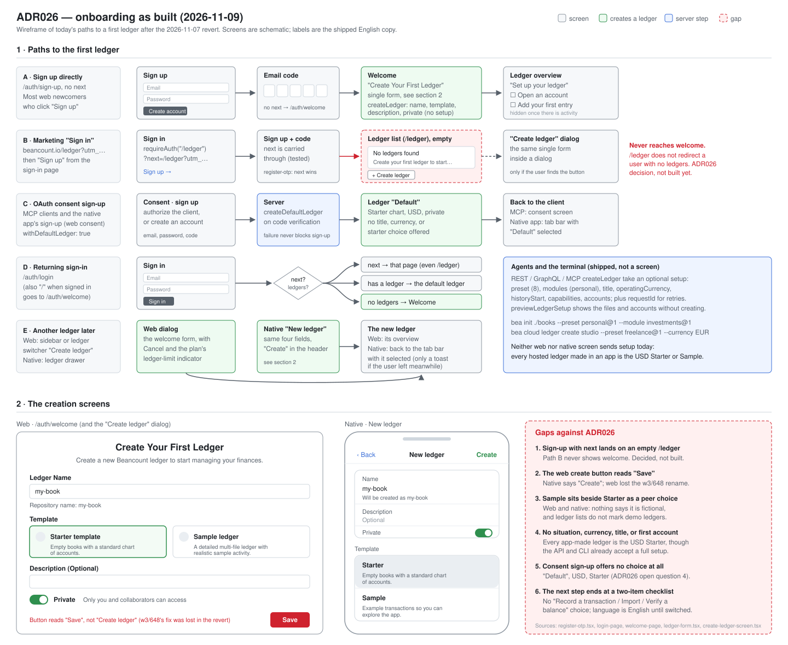
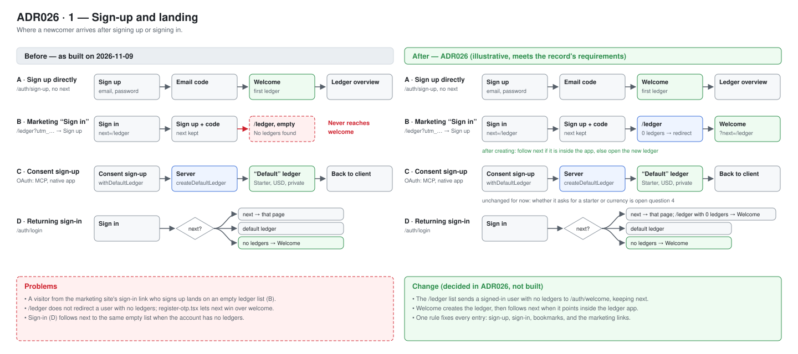
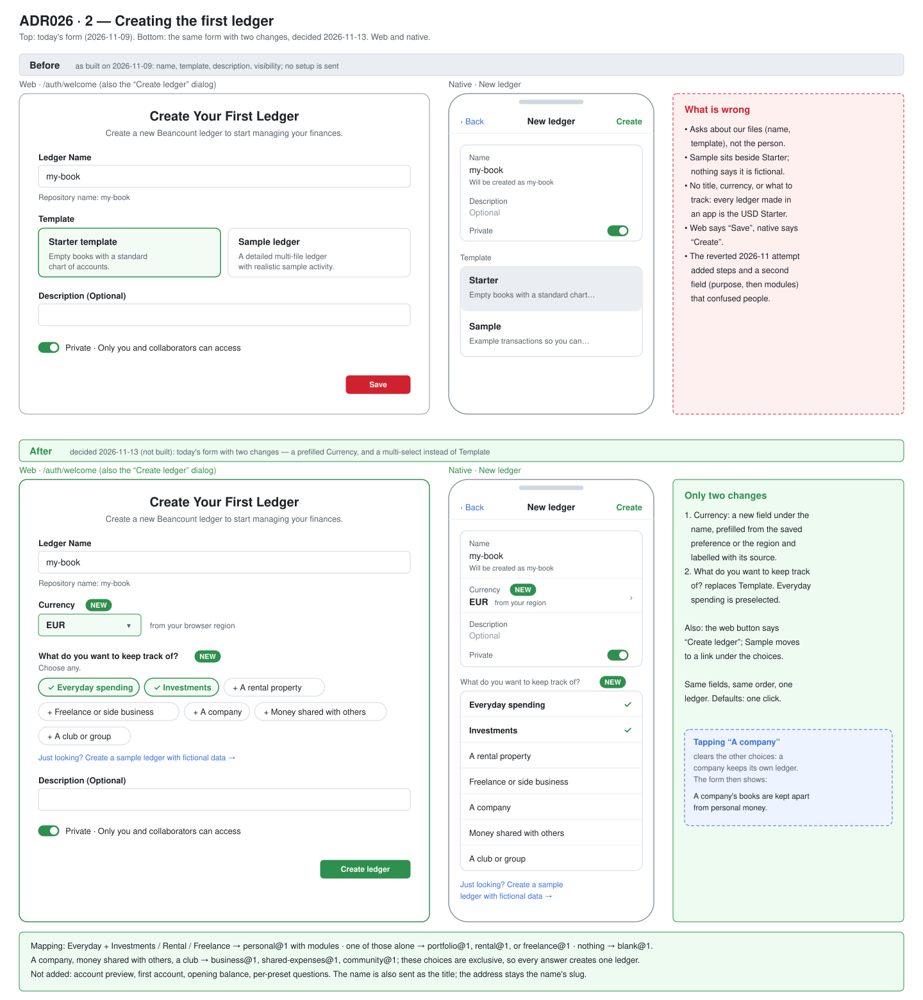
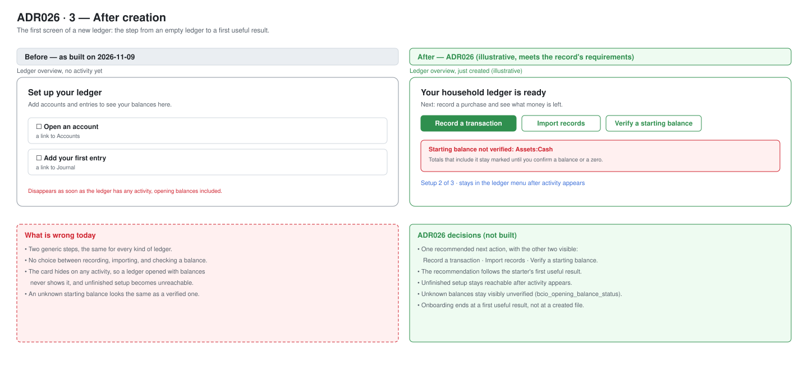
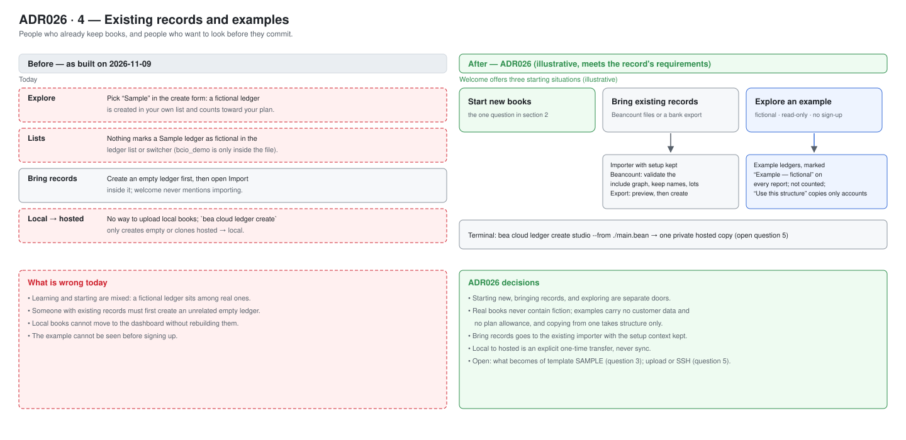
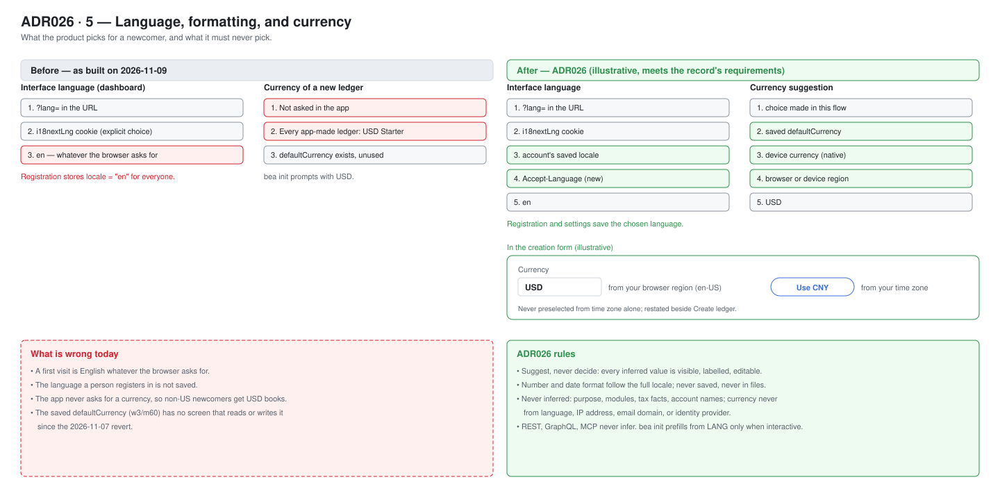

# ADR 0026: Onboarding — from sign-up to the first useful result

- Status: Suspended (2026-11-12)
- Date: 2026-11-08
- Owners: Product, dashboard, mobile, backend-v2, CLI
- Baseline: source tree read on 2026-11-08
- Replaces: PRFAQ001 (Start a ledger that fits your life and work), ADR021 (Ledger creation experience), and the 2026-10-26 ADR026 (Locale, language, and currency defaults). Those three described one journey from three angles, disagreed on which governed, and drifted from the code; they are deleted. Number 021 stays unused, like 004–006.
- Scope: everything between a visitor deciding to try Beancount.io and their first useful financial result: sign-up and where it lands, creating the first ledger, the shared setup contract every client and agent uses, the starter catalog, language and currency defaults, and the first steps after creation. This record adds no roadmap items; only `/pm` writes the board.

> **Suspended 2026-11-12 by the owner.** The design, especially the creation form in [section 2](#2-creating-the-first-ledger), is not yet good enough to build. Until a new owner decision revives this record, do not schedule work from it. Still in effect: what is already shipped (the setup specification, preview, catalog, and idempotent create on REST, GraphQL, and MCP; `bea init` and `bea cloud ledger create` presets; the profile `defaultCurrency`) and today's single creation form, which since 2026-11-12 carries a prefilled Currency field ([w3/m62](../../.pm/w3/README.md)). The decisions marked "not built" below, including the zero-ledger landing and the multi-select form, are paused, not approved.

## Context

A newcomer should go from zero to a ledger that fits their life, with one useful result, in minutes, in the browser, the native app, or the terminal, and an agent should be able to do the same through the API. Three earlier records each covered part of that journey. Measured against the code on 2026-11-08, the result is:

- **The contract is good and shipped.** One versioned setup specification creates a ledger on REST, GraphQL, and MCP, with a preview, idempotent retries, a catalog of eight starters and three personal modules, and the same presets in `bea init` and `bea cloud ledger create`. See [What is built](#what-is-built).
- **The guided screens were not good, and were reverted.** A staged flow (w3/m54, 2026-10-20) and its two-step successor (w3/m60, 2026-11-01) put nine choice cards on the first screen: eight purposes plus a separately boxed Sample. Each card was described by the starter's internal first-result line ("Record a purchase and understand its effect on money remaining"), not by who it is for. A note that only made sense under Personal ("a company, a club, or money shared with other people belongs in its own ledger") sat between the groups for every choice, and nothing said the separated Sample was fictional. On 2026-11-07 the owner judged it too rough and both clients went back to the single form: name, Starter or Sample, description, visibility.
- **Nobody owned the moment after sign-up.** A visitor who follows the marketing site's sign-in link (`/ledger?utm_…`), then signs up, is sent back to `next` = `/ledger`, an empty ledger list. They never see the welcome page, because only a sign-up without `next` goes there ([`register-otp.tsx`](../../dashboard/src/features/auth/pages/register/register-otp.tsx)) and the list does not redirect a user with no ledgers.



This record keeps what works, decides the one-form creation design, and fixes the landing.

## Principles

1. **Defaults finish the job.** Accepting every default reaches a valid, private, empty-of-fiction ledger in one action. Every extra question must change the books, and must say how in one sentence.
2. **Suggest, never decide.** Signals such as language, region, time zone, or a saved preference may prefill a choice the person can see and undo. The more permanent the effect, the more visible the suggestion. Nothing about a person's circumstances (purpose, modules, tax facts) is ever inferred.
3. **Real books never contain fiction.** Example transactions, invented balances, identities, and documents live only in a separate, clearly labelled example. An unknown balance is never shown as a verified zero.
4. **One contract, every surface.** The dashboard, the native app, the CLI, REST, GraphQL, and MCP create ledgers from the same setup specification and get the same files. Nothing is configurable from one client alone. Machine callers never infer: an omitted field takes the documented default, never hidden account state.
5. **Creation is only the start.** A valid empty ledger completes creation but not onboarding. The journey ends at a first useful result: a purchase and its effect, an unpaid invoice, a holding and its cost, who owes whom.

## The journey

### 1. Sign-up and landing



| Entry | Lands on |
| --- | --- |
| Sign-up with no ledgers (any route, including `next` pointing inside the ledger app) | The welcome page, which creates the first ledger. A `next` inside the app is carried through and followed after creation. |
| Sign-up through MCP or mobile OAuth consent | Creates the default ledger during sign-up (`withDefaultLedger`), then returns to consent, as today. |
| Sign-up whose `next` is outside the ledger app (the marketing site's `/pricing`) | That destination, as today. |
| Sign-in with ledgers | `next`, else the first ledger, as today. |

**Decision:** a signed-in user with no ledgers who opens the ledger list (`/ledger`) is redirected to the welcome page, keeping `next`. This mirrors the welcome loader, which already sends a user with ledgers away from welcome, and fixes every entry path at once. Not yet built.

The default ledger created during consent sign-up is private and uses the current Starter chart (shipped, commit `80e3b7cd`). Whether it should take a starter or a currency choice is [open question 4](#open-questions).

### 2. Creating the first ledger



**Today (since 2026-11-07):** the welcome page and the "new ledger" dialog share one form ([`ledger-form.tsx`](../../dashboard/src/features/ledger-list/components/ledger-form.tsx)): a suggested name (`my-book`), Starter ("empty books with a standard chart of accounts") or Sample, an optional description, and private on by default. The native [Create Ledger screen](../../mobile/src/screens/create-ledger-screen/create-ledger-screen.tsx) has the same fields. Neither sends a `setup` specification.

**Decision (owner, 2026-11-10, revised 2026-11-12 and 2026-11-13): keep today's form and change two things.** Creating a ledger should stay as easy as it is today, so the new form looks like the old one, field for field, in the same order. It creates one ledger, has no steps, no review page, and no field that appears after another choice:

| Today | New |
| --- | --- |
| Ledger Name (`my-book`) | Ledger Name (`my-book`), unchanged; also sent as the ledger's title |
| — | **Currency**, prefilled and labelled with its source, for example "EUR · from your browser region" ([how](#language-formatting-and-currency)) |
| Template: Starter or Sample | **What do you want to keep track of?** Choose any: Everyday spending (preselected), Investments, A rental property, Freelance or side business, A company, Money shared with others, A club or group |
| Description (Optional) | unchanged |
| Private | unchanged |
| **Save** | **Create ledger** (editing an existing ledger keeps **Save**) |

Below the choices, one line keeps today's Sample: **Just looking? Create a sample ledger with fictional data**. It is a link, not a choice, so fiction never mixes with a real ledger.

Nothing else is added: no account preview, no first account or opening balance, no per-preset questions (every capability starts `deferred` and is asked at first use). Accepting every default is one click and creates one private personal ledger in the suggested currency.

**Personal and group choices.** The first four choices describe one person's or household's money and combine freely. A company, money shared with others, and a club belong to someone else and get their own ledger, so these three are exclusive: choosing one clears the other choices, and choosing any other clears it. Under a group choice the form shows one line: "A company's books are kept apart from personal money."

How the choices become the ledger (pure client mapping onto the shipped specification, no API change):

| Chosen | Creates |
| --- | --- |
| Everyday spending, alone or with any of Investments, A rental property, Freelance or side business | `personal@1` with the matching modules (`investments@1`, `rental-property@1`, `side-business@1`) |
| Exactly one of Investments, A rental property, Freelance or side business, without Everyday spending | `portfolio@1`, `rental@1`, or `freelance@1` |
| Two or more of those three, without Everyday spending | `personal@1` with those modules |
| A company · Money shared with others · A club or group | `business@1`, `shared-expenses@1`, or `community@1` |
| Nothing | `blank@1`, an empty ledger |

The native **New ledger** screen gets the same two changes in the same places: a Currency row under Name, and the choices as a checklist where Template was, with **Create** in the header as today. A retried create returns the same ledger (`requestId`).

The starter files each mapping produces are in [Appendix A](#appendix-a-generated-starter-files). Before it ships, the form is tried with real people (see [Validation](#validation)), not only with tests.

### 3. After creation



Show one recommended next action with the others visible: **Record a transaction**, **Import records**, or **Verify a starting balance**, extending the overview's existing [empty-ledger setup](../../dashboard/src/features/reports/overview/components/empty-ledger-setup.tsx). That checklist hides once the ledger has activity ([`hasOverviewActivity`](../../dashboard/src/features/reports/overview/lib/overview-utils.ts)), so opening balances alone would hide it; unfinished setup must stay reachable. Not yet built.

### 4. Existing records and examples



- **Bring existing records** routes to the [importer](../../dashboard/src/features/importer/AGENTS.md) with setup context kept. Existing Beancount files keep their account names, commodities, lots, and metadata; nothing is uploaded wholesale.
- **Local to hosted:** an explicit `bea cloud ledger create --from ./main.bean` that validates the include graph and creates a private hosted ledger from those files. One-time transfer, not sync. Not yet built; see [open question 5](#open-questions).
- **Examples** are a separate, clearly marked experience readable before sign-up, holding no customer data and not counted against a ledger allowance. Creating real books from an example copies only deliberately chosen structure. Today the closest thing is the `SAMPLE` template, which creates a fictional ledger marked with `bcio_demo` metadata.

## Setup specification

`setup` is one optional object on ledger creation. Callers that omit it get today's Starter, unchanged. Shipped on REST (`POST /api-gateway/v1/ledgers`), GraphQL (`createLedger`), and MCP (`createLedger`), in w3/m53 and w3/m59.

| Field | Meaning | Default |
| --- | --- | --- |
| `preset` | `personal@1`, `freelance@1`, `business@1`, `portfolio@1`, `rental@1`, `shared-expenses@1`, `community@1`, or `blank@1` | — (required within `setup`) |
| `modules` | Personal only: `investments@1`, `rental-property@1` (optional ASCII property name, default `Property1`), `side-business@1`, each at most once | None |
| `title` | Human-readable title in any script, written as the Beancount `title` option | The preset's suggested title |
| `operatingCurrency` | One supported code (active ISO 4217) | `USD` |
| `historyStart` | Date the books begin, for `open` directives and the opening boundary | The creation date |
| `capabilities` | Each optional question: `enabled`, `declined`, or `deferred` | `deferred` |
| `accounts` | First accounts: kind (bank, cash, card, other), name, currency, and opening state `unknown`, `zero`, or `known` with a signed amount | None |

Rules:

- `setup` and `template` are mutually exclusive; `SAMPLE` with `setup` is refused identically on every surface. `setup` is creation-only and absent from updates.
- An explicit value is validated and never silently replaced. An unknown preset or module, an unsupported currency, an impossible date, a module with a preset other than personal, or an account the preset does not allow creates nothing.
- `unknown`, `zero`, and `known` stay distinct. `unknown` writes no posting and marks the account unverified in portable metadata (`bcio_opening_balance_status`); `zero` is a confirmed start; `known` writes the opening transaction the day before `historyStart` and a balance assertion on it. Money the customer says they owe is stored as the negative liability posting.
- `name` stays the ASCII repository address. Clients suggest it from the title and fall back to `my-book` when the title cannot form one (`家計簿`). The server never derives an address.
- **Preview** (`previewLedgerSetup` on GraphQL, its REST and MCP twins) runs the same builder and validation under the same `LEDGER_CREATE` authorization and creates nothing.
- **Idempotent create:** an optional `requestId` (1–200 characters). Within 24 hours the same id with the same request returns the original ledger, the same id with a different request is a validation error, and a repeat while the first attempt runs is a retryable in-progress answer. Entry writes use the same contract (w3/m61).
- **Older backends** refuse `setup` and `requestId` as unknown input. A client must say "this server does not support guided setup" and offer the server's defaults as an explicit choice, never drop the fields and retry silently. Deploy backend support before any client sends them.
- Parity follows the [required workflow](../../backend-cluster/backend-v2/AGENTS.md#required-api-parity-workflow). Sign-up's default-ledger options are GraphQL-only by the documented session-ceremony exemption.

## Starter catalog

The catalog ([`setup/catalog.json`](../../backend-cluster/backend-v2/src/features/ledger/setup/catalog.json), with a generated copy in the CLI and a drift check) defines each preset's account groups, optional questions, metadata keys, and currency tables. [`fixtures.json`](../../backend-cluster/backend-v2/src/features/ledger/setup/fixtures.json) pairs specifications with expected accounts and report values, and both engines (the Python CLI and the hosted ledger service) must produce equal results before a preset or module is listed. A new preset version, never an edit, changes a published preset; existing account names and history never change because a preset did.

| Preset | For | Questions asked at first use (never at creation) | Acceptance scenario |
| --- | --- | --- | --- |
| `personal@1` | Everyday and household money, including cash-only, students, retirees | Track whose income or assets these are; the module list counts as the second | Opening cash 100, purchase 12.50: cash 87.50, expense 12.50. An unknown opening leaves the total unverified. |
| `freelance@1` | Independent work kept apart from personal money | Track invoices before payment; review by client or project | Invoice 1,000, payment 400: receivables 600, bank +400, revenue booked once. |
| `business@1` | A company's books, funding, and an opening position | Invoices and supplier bills before payment; equipment over time | Capital 1,000, loan 500: bank 1,500, loan 500, equity 1,000, no revenue. |
| `portfolio@1` | Stocks, funds, crypto kept on their own | Bring investments you already own | Buy 10 at 20 with fee 2: 10 units, cash −202, cost 200 and fee 2 recoverable. |
| `rental@1` | Rental property kept on its own | More than one property; a loan for the property | Rent 1,000 and deposit 500: cash +1,500, income 1,000, deposit liability 500. |
| `shared-expenses@1` | Trips and housemates settling shares | A shared cash pot; split equally by default | A pays 90 for A, B, C: A owed 60, B and C owe 30; after B repays, B owes 0. |
| `community@1` | Clubs and associations | Money set aside for named projects; dues by member | Contributions 500, event 120: funds 380. |
| `blank@1` | Experts, accountants, automation | None | Valid file, no accounts; the user adds their own. |

Personal modules each add one name-spaced account group, so they never collide and order does not matter: investments (`Assets:Brokerage`, dividends, interest, capital gains, fees), a rental property (`Income:Rent:<Name>`, `Liabilities:Deposits:<Name>`, `Expenses:Rental:<Name>:…`), and a side business (`Assets:Business:Bank`, `Income:Business:Services`, `Expenses:Business:…`). Names follow the customer skills so `beancount-trade` and `beancount-property` work lands in the same accounts.

Optional account groups beyond the base set, enabled by a question or later at first use: freelance adds receivables; business adds receivables and payables, fixed assets, loans, and separately stated tax balances; rental adds a loan and property-level attribution. Payroll, inventory and cost of goods sold, advanced investment imports, and fund accounting follow validated demand as later presets or versions.

Across all starters:

- Import compatibility: populated starters must include the importer's review account (`Expenses:Uncategorized`) or a supported mapping. Not yet: no shipped starter opens it (see [Appendix A](#appendix-a-generated-starter-files)).
- Evidence, not tax answers: keep the facts future tax work needs (original dates and amounts, currencies, counterparties, source documents, ownership, invoice and settlement dates, lots and acquisition records) when they come up in a transaction or import, and leave missing facts visibly unknown. A starter never decides deductibility, elects a tax method, or marks books tax-ready. Tax profiles and filing are separate later work.
- Language and currency never multiply the catalog; they are configuration.

## Language, formatting, and currency



Inference happens only on a client a person is looking at; servers never infer.

| Setting | Where it lands | Rule |
| --- | --- | --- |
| Interface language | The interface | Picked automatically; saved to the account once the customer chooses one |
| Number and date format | Display and input parsing | Follows the full browser or device locale through `Intl`; never saved, never written to a ledger |
| Operating currency of a new ledger | The ledger's files | Prefilled in the form's Currency field, labelled with its source, editable; never applied silently |
| Starter, modules, tax facts, account names | The ledger's structure | Never inferred |

**Interface language**, first match wins: `?lang=`, then the `i18nextLng` cookie (written only by an explicit choice), then the account's saved `locale`, then the request's `Accept-Language`, then `en`. An inferred language is never saved. Registration stores the language the customer registered in instead of the hardcoded `"en"` ([`auth-service.ts`](../../backend-cluster/backend-v2/src/features/auth/service/auth-service.ts)), and changing language while signed in writes `locale` through `updateProfile`. Not yet built.

**Saved currency preference:** the account's nullable `defaultCurrency` (shipped in w3/m60: readable on REST, GraphQL, and MCP; written only through GraphQL `updateProfile`). It is written when the customer changes a suggested currency during creation or in settings, and when an unchanged suggestion is accepted while none is stored. It is a suggestion, never a constraint, and API creation never reads it.

**Currency suggestion**, resolved once per flow and kept across re-renders, back navigation, errors, and OTP:

1. An explicit selection in this flow.
2. The saved `defaultCurrency`.
3. The device's native currency (`expo-localization` `currencyCode`).
4. The currency of an explicit browser or device region, through the catalog's region table (a region with exactly one legal-tender currency).
5. `USD`.

When step 4 applies and the browser's time zone maps to a different currency, step 4 stays preselected and the time-zone currency appears beside it as a one-tap candidate ("**USD** · **CNY** · Other…"), each with its source in words. Time zone alone never selects. Language alone never selects (`zh` does not mean CNY), nor do IP address, email domain, or identity-provider profile.

**Machine callers:** REST, GraphQL, and MCP never infer; `Accept-Language` affects only message text. Interactive `bea init` may prefill the currency from the POSIX locale (`LC_ALL`, `LC_MONETARY`, `LANG`) through the region table, else `USD`; unattended `bea init` without `--currency` still exits 2. `bea cloud ledger create` passes only what the caller supplies.

**Privacy:** the server receives only resulting values, never raw time zone, device locale, or region. Analytics record the currency suggestion's source and whether it was changed, never currency values, titles, or account names.

## What is built

| Part | Status |
| --- | --- |
| Setup specification, preview, catalog, fixtures, both engines | Shipped (w3/m53, w3/m59) on REST, GraphQL, MCP |
| `requestId` idempotent creation | Shipped (w3/m53); entry writes too (w3/m61) |
| `bea init --preset/--module/--title`; `bea cloud ledger create --preset/--module/--title/--currency` with a `requestId` | Shipped |
| Private default ledger at consent sign-up; Starter without example money | Shipped (`80e3b7cd`, `2d754ae2`) |
| `defaultCurrency` on the profile | Shipped (w3/m60) |
| Guided creation screens on web and native | Shipped 2026-11-01, reverted 2026-11-07; single form today |
| Web create button labelled **Create ledger** | Lost in the revert, restored with w3/m62 |
| Zero-ledger landing on welcome | Not built |
| Next step after creation | Not built |
| Language from `Accept-Language`, saved `locale`, CLI locale prefill | Not built |
| Currency suggestion on screen | Reverted with the guided screens. Since w3/m62 the single form has one Currency field for Starter, prefilled from the saved `defaultCurrency`, then the device or browser region, then USD, with no source label or time-zone candidate. `createLedger` takes an optional `currency`; a request without it is unchanged |
| Sign-up currency for the default ledger | Not built |
| Local-to-hosted `--from`, example experience before sign-up | Not built |

## Open questions

1. **Time zone or browser region first** for the currency suggestion? Measurement decides.
2. **Title in ledger lists.** Lists read repository metadata, which has no title. Store a copy, or read options per ledger? Show title, address, or both?
3. **Sample's future.** Keep `template: SAMPLE` as an API value, retire it, or turn it into the example experience? It is a published contract on three surfaces.
4. **Sign-up's default ledger.** Keep the Starter, use `personal@1`, or offer a choice? Collect a title or currency?
5. **Local-to-hosted transfer.** Upload files through the API, or create an empty ledger and push over SSH? `.pm/DO_NOT_DO.md` requires SSH-key setup for hosted-to-local as a bot defense; does it apply in this direction?
6. **Server-side resume.** Is a draft resumable on another device required, or is the browser session enough?
7. **Catalog content.** Labels, categories, and question wording, to be refined by research.
8. **Plans and limits.** How are ledger limits shown before creation?
9. **Starter naming.** The standalone presets and the modules name the same things differently (Appendix A review notes). Align them in a new preset version before the form ships?
10. **Chinese variants and native `ja`/`ko`.** Does `zh` serve `zh-TW` and `zh-HK`? Mobile lacks the dashboard's `ja` and `ko`.

## Validation

Before a guided creation design ships:

1. Two rounds of 8–10 people, accounting beginners and experts, browser and terminal, including non-English, decimal-comma, right-to-left, and screen-reader sessions, each completing a task such as "start books for your household" or "for your side business". At least 80% finish unaided, and simple new books take under two minutes to create and under five to a first result.
2. Accepting every default creates one private ledger in the suggested currency in one click, on web and native. The form keeps today's fields and order; every answer creates exactly one ledger, and choosing a group choice clears the personal choices and the reverse.
3. The same specification through REST, GraphQL, and MCP creates identical files; every catalog acceptance scenario passes on both engines.
4. Unknown, zero, known, debt, overdraft, non-USD, multi-currency, and historical starts behave as specified, and an unknown balance is never reported as zero after clone or transfer.
5. A retried create returns the same ledger; a timeout produces neither a false success nor a second ledger.
6. A user with no ledgers lands on welcome from every sign-up path, and a `next` inside the app is honored after creation.
7. Language and currency behave as specified: `Accept-Language: ja` renders Japanese on a first visit; `en-US` in `Asia/Shanghai` preselects USD with CNY as a labelled candidate; two creations differing only in language, region, or time zone produce the same structure.

Measure the funnel as **sign-up → ledger created → starting position established → first useful result → continued use**, by entry point. A created file, demo activity, and a positive chart are not the same event, and fictional entries never count. Do not log titles, account names, balances, or file contents.

## Risks

- **Rough screens again.** The contract made the 2026-10 attempt look done before anyone tried it. Test with people before shipping, not after.
- **Two engines, one result.** Divergent builders produce books that differ after transfer; the shared fixtures are the control.
- **Opening boundaries.** A wrong date or a padded difference double-counts money; never pad silently.
- **Compatibility.** Older apps, scripts, and backends keep working because every new field is optional and unsupported servers fail loudly.
- **Hidden state.** A saved preference that changed API results would surprise agents, so machine callers ignore it by design.

## Appendix A: Generated starter files

For review. The creation form is a multi-select, so a ledger is **one preset plus the chosen modules**. Everyday spending is the base (`personal@1`); Investments, A rental property, and Freelance or side business each add one module's accounts on top. The builder keeps the modules disjoint and sorts the result, so the file is the base plus the union of the chosen modules, whatever order they were picked in (checked: no account in two modules, and reversed order gives the identical file).

Every block below is what the shipped builder (`previewLedgerSetup` in [`build-ledger.ts`](../../backend-cluster/backend-v2/src/features/ledger/setup/build-ledger.ts)) produces with the form's defaults: the ledger name `my-book` as the title, `USD` (the form prefills the suggested currency instead), `historyStart` = the creation day (2026-11-10 here), no first accounts, every capability deferred. Each file passes `bea check`. Nothing is invented: no balances, no transactions.

### A.1 Every combination of choices

| Choices | Specification | Accounts |
| --- | --- | --- |
| Everyday spending | `personal@1` | 12 |
| Everyday + Investments | `personal@1` + `investments@1` | 17 |
| Everyday + A rental property | `personal@1` + `rental-property@1` | 18 |
| Everyday + Freelance or side business | `personal@1` + `side-business@1` | 18 |
| Everyday + Investments + A rental property | `personal@1` + `investments@1` + `rental-property@1` | 23 |
| Everyday + Investments + Freelance or side business | `personal@1` + `investments@1` + `side-business@1` | 23 |
| Everyday + A rental property + Freelance or side business | `personal@1` + `rental-property@1` + `side-business@1` | 24 |
| Everyday + all three | `personal@1` + all three modules | 29 |
| Investments only | `portfolio@1` | 6 |
| A rental property only | `rental@1` | 9 |
| Freelance or side business only | `freelance@1` | 10 |
| Two or three of those, without Everyday | `personal@1` + those modules: the same as the matching Everyday row | as above |
| A company | `business@1` | 8 |
| Money shared with others | `shared-expenses@1` | 4 |
| A club or group | `community@1` | 9 |
| Nothing | `blank@1` | 0 |

A known starting balance, entered later through **Verify a starting balance** or sent by an API caller, adds `Equity:OpeningBalances` if the starter lacks it, an opening transaction the day before `historyStart`, and a `balance` assertion on it.

### A.2 The base: Everyday spending (`personal@1`)

```beancount
option "title" "my-book"
option "operating_currency" "USD"
option "inferred_tolerance_default" "*:0.001"

2026-11-10 open Assets:Bank
2026-11-10 open Assets:Cash
2026-11-10 open Equity:OpeningBalances
2026-11-10 open Expenses:Food
2026-11-10 open Expenses:Health
2026-11-10 open Expenses:Housing
2026-11-10 open Expenses:Other
2026-11-10 open Expenses:Transport
2026-11-10 open Expenses:Utilities
2026-11-10 open Income:General
2026-11-10 open Liabilities:CreditCard
2026-11-10 open Liabilities:Loan
```

### A.3 What each module adds to the base

Each block lists only the lines the module adds; the rest of the file is A.2.

**Investments (`investments@1`)**, +5 accounts

```beancount
2026-11-10 open Assets:Brokerage "FIFO"
2026-11-10 open Expenses:Brokerage:Fees
2026-11-10 open Income:CapitalGains
2026-11-10 open Income:Dividends
2026-11-10 open Income:Interest
```

**A rental property (`rental-property@1`; the property name defaults to `Property1`)**, +6 accounts

```beancount
2026-11-10 open Expenses:Rental:Property1:Insurance
2026-11-10 open Expenses:Rental:Property1:Management
2026-11-10 open Expenses:Rental:Property1:Other
2026-11-10 open Expenses:Rental:Property1:Repairs
2026-11-10 open Income:Rent:Property1
2026-11-10 open Liabilities:Deposits:Property1
```

**Freelance or side business (`side-business@1`)**, +6 accounts

```beancount
2026-11-10 open Assets:Business:Bank
2026-11-10 open Expenses:Business:Fees
2026-11-10 open Expenses:Business:Software
2026-11-10 open Expenses:Business:Supplies
2026-11-10 open Expenses:Business:Travel
2026-11-10 open Income:Business:Services
```

### A.4 Composed example: Everyday + Investments

The ledger in the creation wireframe: A.2 plus the Investments block.

```beancount
option "title" "my-book"
option "operating_currency" "USD"
option "inferred_tolerance_default" "*:0.001"

2026-11-10 open Assets:Bank
2026-11-10 open Assets:Brokerage "FIFO"
2026-11-10 open Assets:Cash
2026-11-10 open Equity:OpeningBalances
2026-11-10 open Expenses:Brokerage:Fees
2026-11-10 open Expenses:Food
2026-11-10 open Expenses:Health
2026-11-10 open Expenses:Housing
2026-11-10 open Expenses:Other
2026-11-10 open Expenses:Transport
2026-11-10 open Expenses:Utilities
2026-11-10 open Income:CapitalGains
2026-11-10 open Income:Dividends
2026-11-10 open Income:General
2026-11-10 open Income:Interest
2026-11-10 open Liabilities:CreditCard
2026-11-10 open Liabilities:Loan
```

### A.5 Investments only (`portfolio@1`)

```beancount
option "title" "my-book"
option "operating_currency" "USD"
option "inferred_tolerance_default" "*:0.001"

2026-11-10 open Assets:BrokerCash
2026-11-10 open Assets:Holdings
2026-11-10 open Equity:OpeningBalances
2026-11-10 open Expenses:Fees
2026-11-10 open Income:Dividends
2026-11-10 open Income:Interest
```

### A.6 A rental property only (`rental@1`)

```beancount
option "title" "my-book"
option "operating_currency" "USD"
option "inferred_tolerance_default" "*:0.001"

2026-11-10 open Assets:Bank
2026-11-10 open Assets:Cash
2026-11-10 open Equity:OpeningBalances
2026-11-10 open Expenses:Insurance
2026-11-10 open Expenses:Management
2026-11-10 open Expenses:PropertyOther
2026-11-10 open Expenses:Repairs
2026-11-10 open Income:Rent
2026-11-10 open Liabilities:Deposits
```

### A.7 Freelance or side business only (`freelance@1`)

```beancount
option "title" "my-book"
option "operating_currency" "USD"
option "inferred_tolerance_default" "*:0.001"

2026-11-10 open Assets:Bank
2026-11-10 open Assets:Cash
2026-11-10 open Equity:OwnerContributions
2026-11-10 open Equity:OwnerDrawings
2026-11-10 open Expenses:Fees
2026-11-10 open Expenses:Software
2026-11-10 open Expenses:Supplies
2026-11-10 open Expenses:Travel
2026-11-10 open Income:Services
2026-11-10 open Liabilities:CreditCard
```

### A.8 A company (`business@1`)

```beancount
option "title" "my-book"
option "operating_currency" "USD"
option "inferred_tolerance_default" "*:0.001"

2026-11-10 open Assets:Bank
2026-11-10 open Assets:Cash
2026-11-10 open Equity:Capital
2026-11-10 open Equity:OpeningBalances
2026-11-10 open Equity:RetainedEarnings
2026-11-10 open Expenses:Operating
2026-11-10 open Income:Sales
2026-11-10 open Income:Services
```

### A.9 Money shared with others (`shared-expenses@1`)

```beancount
option "title" "my-book"
option "operating_currency" "USD"
option "inferred_tolerance_default" "*:0.001"

2026-11-10 open Assets:MemberReceivables
2026-11-10 open Equity:OpeningBalances
2026-11-10 open Expenses:Shared
2026-11-10 open Liabilities:MemberPayables
```

### A.10 A club or group (`community@1`)

```beancount
option "title" "my-book"
option "operating_currency" "USD"
option "inferred_tolerance_default" "*:0.001"

2026-11-10 open Assets:Bank
2026-11-10 open Assets:Cash
2026-11-10 open Equity:OpeningBalances
2026-11-10 open Expenses:Administration
2026-11-10 open Expenses:Events
2026-11-10 open Expenses:Projects
2026-11-10 open Income:Contributions
2026-11-10 open Income:Dues
2026-11-10 open Income:Events
```

### A.11 Nothing (`blank@1`)

```beancount
option "title" "my-book"
option "operating_currency" "USD"
option "inferred_tolerance_default" "*:0.001"
```

### A.12 Review notes

- **No import review account.** No starter opens `Expenses:Uncategorized`, which the importer needs (see [Starter catalog](#starter-catalog)). Either add it to every populated starter or document the mapping the importer uses instead.
- **The same thing has two names, and multi-select makes it visible.** Picking Investments alone gives `portfolio@1` (`Assets:BrokerCash`, `Assets:Holdings`, `Expenses:Fees`, no capital-gains account); picking Everyday + Investments gives the module's `Assets:Brokerage`, `Expenses:Brokerage:Fees`, `Income:CapitalGains`. A rental property alone gives `Income:Rent`, `Expenses:Repairs`, `Liabilities:Deposits`; with Everyday it gives `Income:Rent:Property1`, `Expenses:Rental:Property1:Repairs`, `Liabilities:Deposits:Property1`. Unchecking Everyday changes every investment account name. One option: map a lone Investments, Rental, or Freelance choice to `blank@1` plus that module, so a choice always means the same accounts; that needs the builder to accept modules without `personal@1` ([open question 9](#open-questions)).
- **Accounts nobody asked for.** Everyday spending opens `Liabilities:Loan` and `Liabilities:CreditCard` for everyone; consider opening them at first use.
- **Shared expenses has no money account.** Members owe through `Assets:MemberReceivables` and `Liabilities:MemberPayables`; a shared pot is a deferred question. Per-member accounts come at first use.
