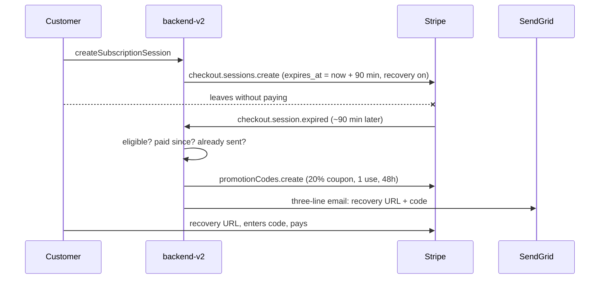

# ADR027: Checkout recovery — one short email, one modest code, once per person

- Status: Accepted — implemented in [w0/m9](../../.pm/w0/blocked/m9/README.md) (2026-11-08); live-mode verification waits on the owner's Stripe and SendGrid setup
- Date: 2026-11-05
- Owners: Product, backend-v2
- Baseline: source tree read on 2026-11-05
- Scope: what happens after a signed-in customer opens Stripe Checkout and leaves without paying. That covers the Checkout session's lifetime, the `checkout.session.expired` webhook, the recovery email and its discount, and the rules that stop it from going to someone who paid or from training customers to wait for it. Plan changes, the Billing portal, mobile purchases ([ADR001](./ADR001-mobile-billing.md)), and any other marketing email are out of scope. It adds no roadmap items; only `/pm` writes the board.

## Context

A customer who reaches Checkout has an account, has picked a plan, and has seen the price. When that customer leaves without paying, nothing happens today: the session sits open for Stripe's default 24 hours, expires, and the webhook handler ignores the event.

The proposal this record evaluates is a single recovery email:

1. Listen for `checkout.session.expired`.
2. Send one short email: the plan you chose is still waiting.
3. Include a single-use 20%-off code that expires in 48 hours.
4. Never send it to someone who has already paid.

It adds three constraints. The email stays within three lines. It goes out one to two hours after the customer left, because the next day is too late. The discount stays at 20%, because a deeper one teaches returning customers to wait for the email before buying.

### What exists today

| Area | As built |
| --- | --- |
| Checkout creation | [`createSubscriptionSession`](../../backend-cluster/backend-v2/src/features/stripe/service/subscription-service.ts) sets `metadata: { userId, clientId }`, `allow_promotion_codes: true`, and either `customer` (returning Stripe customer) or `customer_email`. It sets no `expires_at`, so sessions live Stripe's default 24 hours. It refuses a second Checkout while a paid subscription is current. |
| Surfaces | `Mutation.createSubscriptionSession` is GraphQL-only, a documented billing exception in [`op-class.ts`](../../backend-cluster/backend-v2/src/server/api/op-class.ts). |
| Webhook | [`stripe-webhook-handler.ts`](../../backend-cluster/backend-v2/src/features/stripe/api/stripe-webhook-handler.ts) verifies the signature, drops test-mode events and foreign `clientId`s, and handles subscription, customer, `invoice.upcoming`, `invoice.payment_failed`, and `checkout.session.completed` events. `checkout.session.expired` falls through unhandled. |
| Email | Mail goes through [SendGrid](../../backend-cluster/backend-v2/src/foundation/sendgrid.ts), not Resend. Billing emails use [`sendBillingEmailOnce`](../../backend-cluster/backend-v2/src/features/stripe/operations/billing-email.ts), which claims a key in `sent_billing_emails` before sending and releases it if the send fails, so Stripe redeliveries never send twice. Billing mail is English-only, and every account's `locale` is `en` ([ADR026](./ADR026-dashboard-onboarding.md#language-formatting-and-currency)). |
| Unsubscribe | None. The shared [email footer](../../backend-cluster/backend-v2/src/shared/email-templates/components/email-footer.ts) reserves an `unsubscribeUrl` parameter that nothing fills. |
| Scheduler | [`JobScheduler`](../../backend-cluster/backend-v2/src/scheduler/job-scheduler.ts) runs `node-cron` jobs. There is no delayed-job queue. |

## Decision

### D1. Let the session expiry be the timer

Set `expires_at` on every Checkout session to **90 minutes** after creation. Stripe's minimum is 30 minutes and its maximum is 24 hours. The timer starts when the session is created, not when the customer leaves, and most customers who leave do so within a few minutes. The expired event then arrives roughly 80 to 90 minutes after they left, inside the one-to-two-hour window, with no queue, cron job, or pending-email table. A one-hour expiry would land under an hour after leaving, too early for the window.

Someone still on the payment form after 90 minutes loses the session and starts again from the pricing page. That is rare, and the recovery URL from D3 brings them back to the same cart.

### D2. Send only to people who could buy for the first time

Handle `checkout.session.expired` only when all of these hold:

- the event passes the existing livemode and `clientId` checks, and `metadata.userId` names an existing user with an email address;
- the session's plan is a current, non-retired price in `SUBSCRIPTION_CONFIG`;
- the user has never had a paid subscription: no `paid_customers` binding with any non-free subscription, current or ended;
- the user has no paid subscription now and no Checkout session that completed or is still open since the expired one was created (see D5);
- no recovery email has ever gone to this user (D4).

Any failed check acknowledges the event with `processed: false`, the way the handler treats every other ignored event.

### D3. Bring the customer back to the same cart with a 20% code

Two Stripe objects, created once:

- **Coupon** `checkout-recovery-20`: `percent_off: 20`, `duration: "once"`. For a monthly plan that is the first month; for a yearly plan, the first year. It never discounts a renewal.

One object per email:

- **Promotion code** on that coupon: `max_redemptions: 1`, `expires_at` 48 hours after sending, `restrictions.first_time_transaction: true`, `customer` set when the session had one, and `metadata: { userId, sessionId, source: "checkout-recovery" }`. Stripe generates the code string. On the pinned API version (`2025-12-15.clover`), `promotionCodes.create` names the coupon as `promotion: { type: "coupon", coupon }`, not a top-level `coupon`.

Checkout sessions also set `after_expiration.recovery: { enabled: true, allow_promotion_codes: true }`. The expired session then carries a `recovery.url` that reopens the same plan with the code field available; Stripe marks the new session's `recovered_from`. The new session is a copy of the expired one, so it carries `metadata.userId` and `clientId`, which `checkout.session.completed` needs to bind the customer; a test pins that. The recovery URL stays usable for 30 days, longer than the code: after 48 hours it still reopens Checkout, at full price. If the recovery URL is missing, the email links to the pricing page through the URL `checkoutCancelUrl` builds. That URL carries `plan` and `billing`, but the pricing page reads only `billing` today, so the customer picks the plan again.

Twenty percent is the ceiling. Don't add larger codes, stacked codes, or a second, deeper email.

### D4. Once per person, ever

The idempotency key is `checkout-recovery:<userId>`, claimed in `sent_billing_emails`, the table `sendBillingEmailOnce` uses. It is not keyed by session. Opening Checkout five times and leaving five times yields one email. Leaving again after the code has expired yields nothing. That rule, more than the discount size, is what keeps "don't buy, wait for the email" from working.

This email differs from the other billing emails in one way: its body contains a code that should exist only once the claim is won. `sendBillingEmailOnce` renders before claiming, so the operation uses the `sentBillingEmail` model directly, in this order: claim, create the promotion code, render, send. If the code creation or the send fails, set the code to `active: false` (when one was created), release the claim, and rethrow, so that Stripe's redelivery retries cleanly.

### D5. Don't send to someone who paid

The expired session itself was not paid, but the customer may have paid through another one. Before claiming, the handler:

1. lists subscriptions for the user, as `getUserTier` does, and stops if any is paid;
2. lists Checkout sessions with `created` at or after the expired one's (and `customer` when it had one), keeps those whose `metadata.userId` matches, and stops if any is `complete` (paid, or payment still processing) or `open` (the customer is back in Checkout; if that session also expires, its own event decides). The list endpoint cannot filter by metadata, so the match happens in code; the window is a couple of hours of sessions, so the scan stays small.

A payment that lands in the seconds between this check and the send is not prevented. The customer then holds a code they cannot use (`first_time_transaction`), and the cost is one unneeded email. No later email exists to cancel, so there's nothing to stop after payment.

### D6. A reminder, with an unsubscribe

Owner decision (2026-11-08): this is a reminder about a purchase the signed-in customer started, sent once to their own account address. It is not list marketing, so it is not gated on promotional consent, and sessions do not set `consent_collection`. Stripe's consent checkbox would not cover most customers anyway: it works only when both the business and the customer are in the US.

The risk is that the code makes the email arguably commercial: under CAN-SPAM's primary-purpose test, and under EU and UK e-privacy rules for someone who never bought. The mitigations are the once-per-person rule (D4), the three-line format with no other offer (D7), and a working opt-out. The email carries a one-click unsubscribe (List-Unsubscribe header plus a footer link) through a SendGrid unsubscribe group dedicated to this email. That needs `asm` support in `ISendGrid.sendMail`. SendGrid drops a message sent in the group to anyone who left it, so the operation does not look the address up first. An unsubscribed customer still uses up their one claim and a code nobody receives, which is harmless: the code is single-use, unguessable, and expires in 48 hours. A pre-send lookup was shipped and removed (2026-11-13). It needed the Suppressions read scope, which the production key, restricted to sending mail, does not have. Every expired session failed with a 403 and was redelivered for three days, to protect only that one unused code.

### D7. The email

English, plain, three lines of body, no images, no tracking pixels. The SendGrid account turns on open and click tracking for every mail, which adds a pixel and rewrites each link through a SendGrid redirect. This email turns both off per message (`untracked`), so the button is the recovery URL itself. The first live email went out tracked; that was fixed on 2026-11-14. Subject and body:

> **Subject:** Your Premium plan is still waiting
>
> You left Checkout before finishing — your Premium · Yearly plan is still saved.
> Use **CODE** for 20% off your first year — it expires in 48 hours.
> [Finish checkout]

The plan name uses `planName`, and "first month" or "first year" follows the plan interval. The expiry reads "48 hours", not a date: `longDate` prints a UTC date, and a code that dies at 01:00 UTC on November 7 has already died in the reader's evening of November 6. Then the standard footer and the unsubscribe link. Nothing else: no feature list, no testimonials, no second call to action.

## Consequences

- Recovery is fully automatic once the coupon and the SendGrid group exist. There is no queue and no cron job, and a redelivered webhook cannot send twice.
- Every Checkout session lasts 90 minutes instead of 24 hours.
- Each eligible customer gets at most one discount through this path, only on a first purchase, worth at most 20% of one billing period.
- Measurement comes from Stripe: emails sent (promotion codes with `source: "checkout-recovery"`), redemptions (`times_redeemed`), and recovered sessions (`recovered_from`). No new analytics table.
- Customers who have paid before, or who unsubscribed, get no email. That is deliberate and caps the reach. For someone who unsubscribed, the claim and a code are spent without an email, and the `source: "checkout-recovery"` code count includes them.
- Sending without promotional consent is an owner decision that carries the legal risk named in D6.

## API parity

No customer-facing capability is added. Checkout creation stays GraphQL-only under its existing documented exception, the new parameters apply to every session it creates, and the webhook is an inbound Stripe endpoint, not a customer API. REST, GraphQL, and MCP need no change.

## Implementation outline

| Change | Where |
| --- | --- |
| `expires_at`, `after_expiration.recovery` on session creation | `features/stripe/service/subscription-service.ts` |
| `checkout.session.expired` case calling the operation | `features/stripe/api/stripe-webhook-handler.ts` |
| Eligibility, then claim, promotion code, render, send, with release and deactivation on failure | new `features/stripe/operations/checkout-recovery-email.ts` |
| Coupon ID and SendGrid group ID, pinned in `SUBSCRIPTION_CONFIG` | `features/stripe/service/stripe.ts` |
| `asm` passthrough for the group, and per-message tracking off | `foundation/sendgrid.ts` |
| Enable `checkout.session.expired` on the live webhook endpoint | Stripe Dashboard (owner) |

Tests cover each D2 ineligibility, the once-per-user key across two expired sessions, release-and-deactivate on a failed send, the paid-meanwhile and back-in-Checkout skips, the recovered session keeping `metadata.userId`, and the rendered body staying within three lines. The handler drops test-mode events, so end-to-end verification needs a live-mode session on an owner account.

## Alternatives considered

- **Stripe's own recovery emails** (Dashboard setting). Stripe sends a reminder with the recovery link, but we would not control the copy, the timing, or a per-person discount, and it would duplicate ours. Rejected; keep it off.
- **Keep the 24-hour expiry and schedule the email from a cron job** reading sessions created one to two hours ago. That works, but it adds a polling job and a pending state, all to recreate what `expires_at` already provides. Rejected.
- **Pre-apply the discount** (`discounts` on a fresh session behind our own link). The customer would not type anything, but Stripe forbids `discounts` together with `allow_promotion_codes`, and it needs a new authenticated endpoint. Rejected in favor of the recovery URL plus a code.
- **A series of reminders, or a larger discount on the second email.** This is exactly what teaches customers to wait. Rejected.
- **Gate on Stripe's promotional-consent checkbox.** Stripe collects that consent only when both the business and the customer are in the US, so most customers could never qualify. Rejected by the owner decision in D6.
- **Resend.** It would add a second email provider next to SendGrid without any capability this needs. Rejected.

## Open questions

1. **Returning customers.** Someone who paid before, canceled, and came back to Checkout gets nothing under D2. Should they get a reminder without a code instead?
2. **Holdout.** Should a fixed share of eligible sessions (for example, 10%) get no email, so the lift can be measured rather than assumed?
