# PRFAQ006 — Self-host Beancount.io on bex in one click

Status: Proposed. This is the target experience, written as if released. Nothing in it is marked planned any more: what it describes is built, and follows the decisions of [ADR 0029](../adrs/ADR029-deploy-self-hosting-contract.md). Except where a question says otherwise, it was exercised on a live bex workspace, on 2026-11-09, 2026-11-16, 2026-11-18 and 2026-11-19.

Date: 2026-11-09 (updated 2026-11-14, 2026-11-16, 2026-11-18 and 2026-11-19)

Scope: someone who wants their own Beancount.io, for themselves, with no server to look after. Sign-up takes one account per deployment; more come only through the operator's own identity provider (see question 3). Whether to offer anything beyond that for a team, such as invitations, is left for later and will follow from what users ask for. Docker and local development are covered by their own READMEs.

Evidence baseline: five live runs of the root Blueprint on a bex workspace, all resources deleted after each. The first, on 2026-11-09, ran `main` at `bfe5fdddc`. The second, on 2026-11-16, ran `main` at `34b43768b` (the dashboard and Gitea were redeployed at `8fa681216` during it) and covered what had changed in between. The third, later the same day, started from the Blueprint as it was before Gitea became private (`ae0e4c7ba`), upgraded that stack to `main`, and ran what the second had left unverified. The fourth, on 2026-11-18, ran `main` at `0a90302df` and walked through this document as a new customer would; see [What did the fourth live run find?](#what-did-the-fourth-live-run-find). The fifth, on 2026-11-19, ran `main` at `ee5307632` and ran what was still unverified: accounts through an OpenID Connect provider, an MCP client signing in through OAuth, the mobile app, and restoring the database; see [What did the fifth live run find?](#what-did-the-fifth-live-run-find).

The second run exercised everything that had changed since the first: sign-up closing once the first account exists; Gitea as a private service with ledgers cloned and pushed through the API's Git proxy; the forgot-password page on a server without mail and the operator's one-time reset link; the configuration errors for AI, uploads and `bea ask`; and the places that used to name beancount.io on a self-hosted stack. The third run covered the upgrade of an existing deployment, a backup and restore, the browser sign-in of `bea cloud login`, the mobile app's sign-in protocol, a blocked account, and a 200 MB push; see [What did the third live run find?](#what-did-the-third-live-run-find). What no run covered is listed under [What is not verified?](#what-is-not-verified).

The screenshots are from the fourth run, except sign-up, sign-in and Delete Account, which were taken again on 2026-11-19 on a stack built after those pages stopped showing the hosted service's copy (`5ed926c92`, `a72752a2c`). Platform-assigned hostnames are shown as `xxxx`, and the device name and IP address on the CLI authorization page are placeholders.

## Press release

*Proposed launch copy. This is not a current product announcement.*

**Run your own Beancount.io from one button**

*One button deploys all of Beancount.io (the web app, the API, the MCP server and your ledgers in Git) into your own bex workspace, at its own address, in about half an hour. Nothing to configure, no plan limits, about 33 USD a month in hosting, MIT-licensed.*

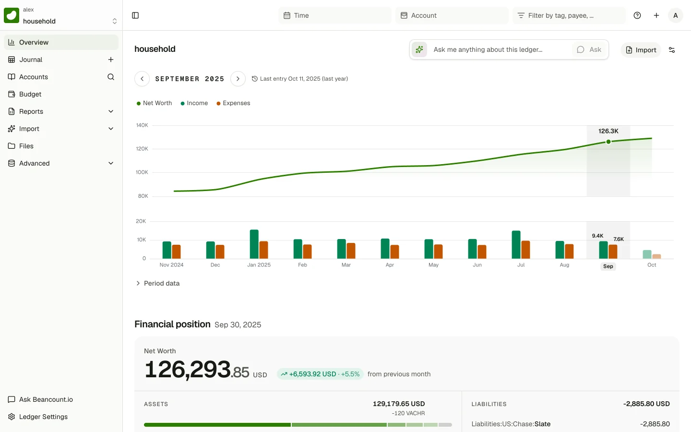

Beancount keeps your finances in plain text you own. The software around that text has been harder to own: a web app, a command line and an agent endpoint on top of your ledger meant either trusting our hosted service with your books or wiring six services together yourself. From today, anyone with a bex workspace can run all of Beancount.io for themselves.

Press **Deploy to bex.co** in the README, pick the workspace that should own the stack, and approve the plan bex shows you. You type in nothing: every secret is generated inside your workspace. About half an hour later the dashboard is live. Create your account and sign-up closes behind you; nobody else gets in unless you let them in through your own identity provider.

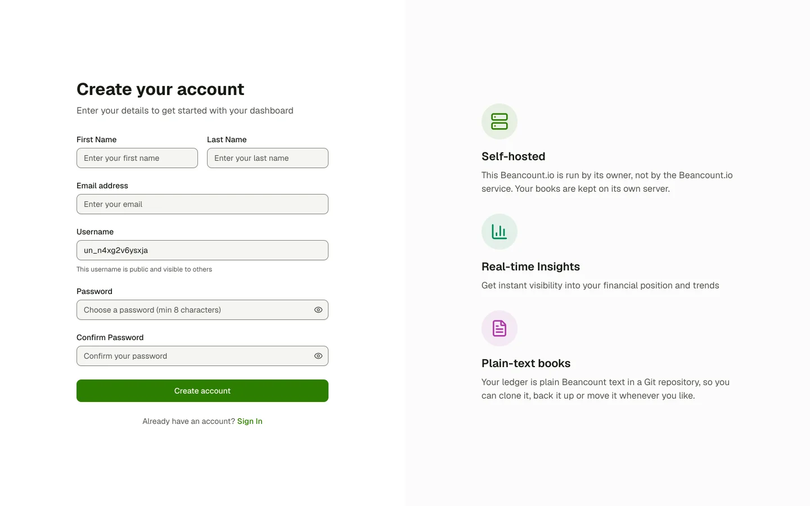

Your ledger is a Git repository on a disk in your workspace, and every way in points at your address, not ours: the dashboard, the `bea` command line, a coding agent through the built-in MCP server, or plain `git`, which `bea` signs in for you with nothing to paste. There are no plan limits on ledgers, directives or AI usage, and the stack sends no analytics or usage data to Beancount.io.

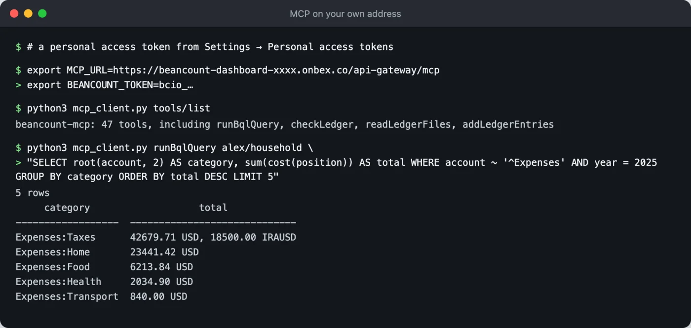

Optional pieces stay off until you add them: a model key for receipt scanning, categorisation and the assistant; an S3 bucket for receipt uploads; a mail key for password reset. Until then, each of those features names the setting it needs, and nothing else is affected.

A few things work their own way. A deployment takes one sign-up, and more accounts come through your own OpenID Connect provider. You choose when to update it. Git runs over HTTPS. bex backs the database up continuously, and your ledgers are Git repositories you can clone. bex is built by the same company as Beancount.io; the hosting runs under bex's terms, and the Beancount.io service is not part of your stack.

To start, open the Self-host section of the [README](../../README.md#self-host). Tell us what breaks in [GitHub issues](https://github.com/bex-co/beancount-io/issues) or the [Telegram chat](https://t.me/beancount).

## Customer FAQ

### 1. What do I get, and what does it cost?

The dashboard (the address you use), the API (it also has an address of its own, see 8), the ledger service and Gitea (both private, with no public address; Gitea keeps its repositories on a 10 GB disk), one managed Postgres and one Key Value store. bex's preview shows **32.97 USD a month** at the current plans, billed to your workspace: 4.90 each for the dashboard, the API and the ledger service, 6.65 for Gitea with its 10 GB disk, 4.41 for Postgres and 7.21 for the Key Value store (preview of 2026-11-18). A model provider, a mail provider or an S3 bucket you add bills you separately. Delete the resources to stop paying; that also deletes your data (question 15). The software is MIT-licensed.

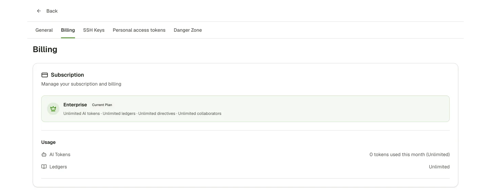

### 2. How do I install it?

1. Open the **Deploy to bex.co** button in the [README](../../README.md#self-host) or [`deploy/bex/`](../../deploy/bex/README.md).
2. Choose the workspace that should own it, review the plan, and apply. Nothing is created until you approve.
3. Wait. The first build is the slow part: **27 to 30 minutes** to a working sign-up in our runs, longer when bex's single build queue is busy.
4. Open the dashboard service's URL and sign up.

You are asked for nothing. If a service shows a failed rollout, trigger a deploy of it again from the bex dashboard; bex does not retry it.

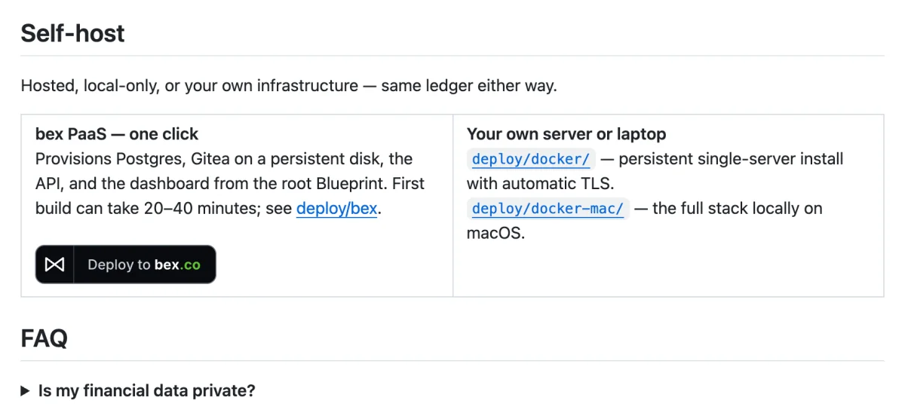

### 3. Who can sign up?

The first person to do it. The stack puts no plan limits on anyone and never proves an email address, so it takes sign-ups only until its first account exists: after that the API refuses `signUp`, and the sign-in page and `/auth/sign-up` stop offering it. Sign up as soon as the deploy is up; until you do, anyone who finds the address could be first. Deleting the only account reopens sign-up.

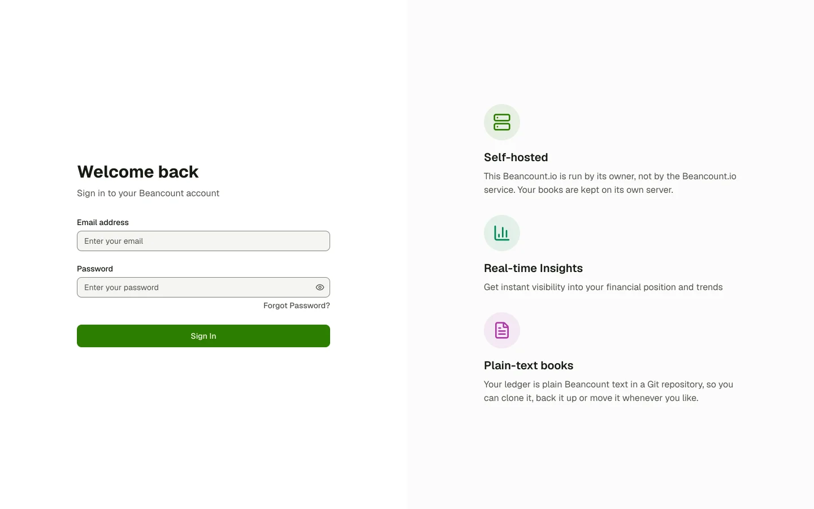

Sign-up never reopens for a second person. The one way to add accounts is your own OpenID Connect provider: set `OIDC_ISSUER`, `OIDC_CLIENT_ID` and `OIDC_CLIENT_SECRET`, and list who may join in `OIDC_ALLOWED_EMAILS` (an address, `@example.com`, or `@*.example.com`). A verified email on that list gets an account the first time it signs in with the provider; without the list, the provider creates no accounts. With a provider anyone can join, list addresses rather than a public domain such as `@gmail.com`. Run on bex on 2026-11-19 with a test provider and sign-up closed: an address on the list got an account at its first sign-in, and an address off the list was turned away. The steps are in [More accounts](../../deploy/bex/README.md#more-accounts-your-own-identity-provider). Anything beyond it, such as inviting someone without a provider, will follow from what users ask for.

### 4. How do I use the command line?

```zsh
export BEA_API_URL=https://<your dashboard address>
export BEA_DASHBOARD_URL=https://<your dashboard address>
bea cloud login            # browser sign-in
bea cloud ledger list
```

On 2026-11-16 `bea cloud login` signed in through the browser this way, and `bea cloud status` and `bea cloud ledger list` then worked with the stored credential (the third live run); on 2026-11-09 the last two also worked with a token in `BEA_TOKEN`.

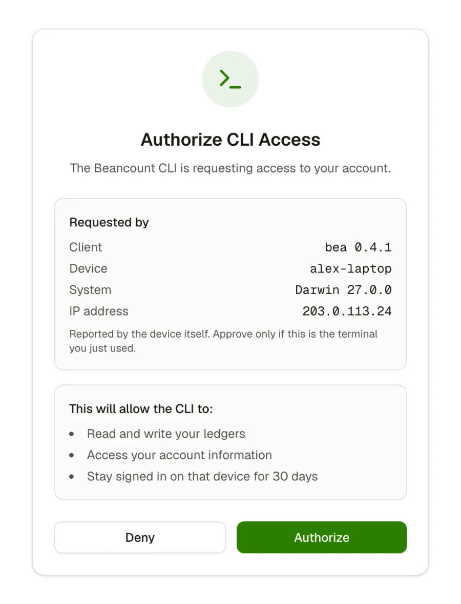

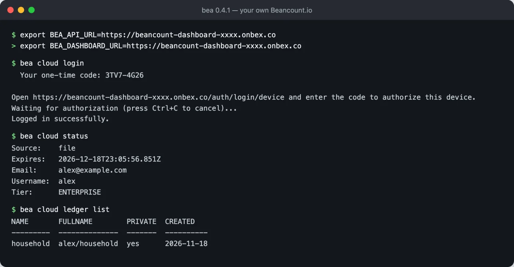

Both variables name the dashboard: it forwards `/api-gateway/` to the API, so the CLI needs only that one address.

To get a ledger's Git history, use plain `git`: every ledger's `httpUrl` is `https://<your API address>/git/<owner>/<ledger>.git`, served by the API's Git proxy (Gitea itself has no public address). Run `bea cloud git setup` once and Git signs in through `bea`, the way `gh auth setup-git` does for GitHub: `git clone`, `git pull` and `git push` ask for no password, and no token ends up in a URL or a `.git/config`. `bea` mints a personal access token for Git (`ledger.read` and `ledger.write`, 90 days), which you can see and revoke under Settings → Personal access tokens, and `bea cloud logout` revokes it. This needs the `bea` release after 0.4.1 and a stack built on or after 2026-11-18; it is built and tested against real `git`, and not yet run on a live bex. On a machine without `bea`, make a personal access token on that page and give it as the password; any username works. `bea cloud ledger clone` clones over SSH only, and bex routes no SSH, so on a bex deployment it stops. From `bea` 0.4.1 it then explains the HTTPS route above: it prints the `git clone` command for that ledger, says to use a personal access token as the password, and says bex cannot serve SSH. (0.4.1 calls the settings page "API keys"; it is "Personal access tokens", and the next release says so.) 0.4.0 says only that the server serves no Git over SSH, and 0.3.1 stops with an unhelpful `expected str … not NoneType`.

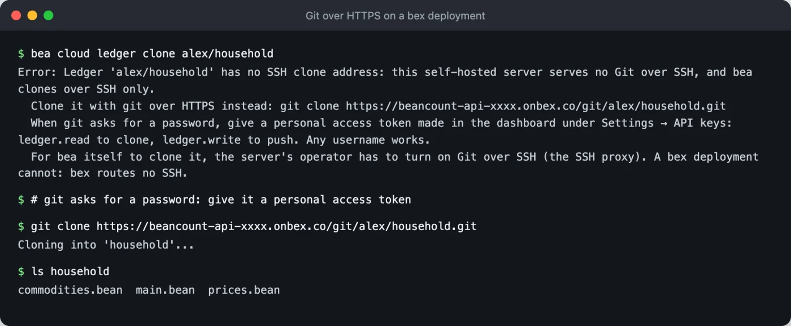

### 5. Can I use the mobile app?

The App Store and Google Play apps keep a server-address override for self-hosted deployments, and they sign in with the custom-scheme redirect rather than a verified link ([ADR 013](../adrs/ADR013-mobile-verified-https-oauth-redirect.md)). On 2026-11-16 we replayed the app's sign-in against a bex deployment from a desktop browser, with the app's own client, redirect and scopes: discovery, the consent page, the redirect back to the app, the token exchange, a ledger read with the app's token, and a token refresh all worked, after one fix (see the third live run). Enter the dashboard's address as the server address. On 2026-11-19 the iOS app (a development build of the store version, on the iOS simulator) took the address, passed its connection test, signed in through the deployment's own pages, and showed the account's ledger. Android has not been run against a bex deployment.

### 6. What doesn't work until I configure it?

| You want | Set | Until then |
| --- | --- | --- |
| Receipt and attachment uploads | `TEMP_ASSETS_AWS_S3_*`, `PERM_ASSETS_AWS_S3_*` | The call fails with a configuration error naming these variables. |
| AI: receipt scan, categories, assistant | `ANTHROPIC_API_KEY` or `OPENAI_API_KEY` | The call fails with a configuration error naming these variables. |
| `bea ask` | `OPENAI_API_KEY` (and optionally `OPENAI_BASE_URL`) | The call fails with a configuration error naming `OPENAI_API_KEY`. |
| Password reset and other mail | `SEND_GRID_API_KEY` | See the next question. |
| Bank connections | `PLAID_*` | Not tested on a self-hosted stack. |
| Sign-in with your own identity provider, and more accounts | `OIDC_ISSUER`, `OIDC_CLIENT_ID`, `OIDC_CLIENT_SECRET`, `OIDC_ALLOWED_EMAILS` | Password sign-in only, and one account (question 3). Run on bex on 2026-11-19. |

Add variables in the bex dashboard's Environment tab; they survive Blueprint syncs. No plan limits apply, so the assistant has no monthly token cap: add a model key after you have signed up, once sign-up has closed. Every account on the stack, including those your `OIDC_ALLOWED_EMAILS` lets in, uses that key.

### 7. I forgot my password and mail isn't set up. What now?

With no mail provider configured, the forgot-password page tells you the server cannot send email and that the person who runs it can help. That person calls `POST /api/admin/password-reset-link` on the API's address with the `ADMIN_TOKEN` ([A user forgot their password](../../deploy/bex/README.md#a-user-forgot-their-password)) and gets a one-time link, good for an hour, on which you set a new password. On a one-person deployment you are both people.

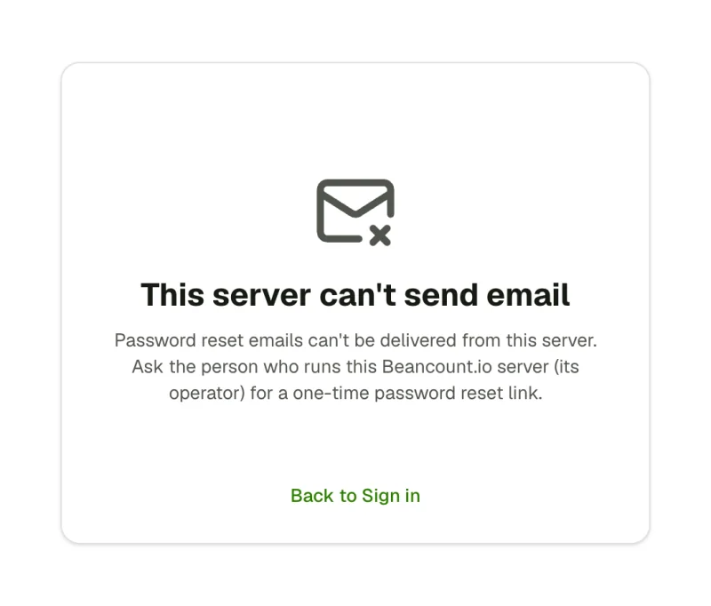

### 8. Is the admin API exposed?

The API service has its own public address and serves `/api/admin/*` there, guarded by the generated `ADMIN_TOKEN` (find it in the API service's environment). Treat that token like a root credential: wrong tokens are refused but never locked out, so it is only as safe as it is secret. The dashboard address does not forward `/api/admin`. Of the six services, only the dashboard and the API have a public address; the ledger service and Gitea are private.

### 9. How do I update it?

A Blueprint made from the button has no push webhook. To take a change: sync the Blueprint for manifest changes, then trigger a deploy of the service with the new commit ([Rolling out a change](../../deploy/bex/README.md#rolling-out-a-change)). Builds queue one at a time, so a full rollout can take most of an hour. Your stack runs the commit of `main` it was built from; the stack has no numbered releases or release notes yet, so read the commit log and the upgrade notes in the bex README before you update. A stack created before Gitea became a private service (before 2026-11-14) needs a backup first: bex cannot change Gitea's type in place, so finishing that upgrade deletes the Gitea service and its disk ([Upgrading a stack that is already running](../../deploy/bex/README.md#upgrading-a-stack-that-is-already-running)).

### 10. Can I use my own domain?

Yes. Give the dashboard and API hosts a shared parent domain, set `AUTH_COOKIE_DOMAIN` to it, and set `DASHBOARD_URL`. With the generated `onbex.co` addresses you need none of this.

### 11. How do I back up my books?

The books are Git repositories on the Gitea disk; accounts, API keys and settings are rows in the managed Postgres. Each ledger: `git clone --mirror` over HTTPS (question 4) is a complete copy of its files and history, and [Back up and restore](../../deploy/bex/README.md#back-up-and-restore) shows how to put it back on a stack. Both were run on a live bex on 2026-11-16; a restore is a merge into a new ledger of the same name, because a forced push is refused. Postgres is backed up by bex, continuously; bex restores it as it was at an earlier time into a new database, and [The database](../../deploy/bex/README.md#the-database) copies that back over the stack's own. Run on bex on 2026-11-19 (the fifth run).

### 12. Is my data private?

Your books stay on your disk and in your database. Nothing is sent to the Beancount.io service and there is no analytics: the browser analytics script is included only when a build sets a measurement ID, and the Blueprint's build does not. A few things do leave the workspace, and these are all of them that we know of:

| What leaves | Where it goes | When |
| --- | --- | --- |
| The first 5 characters of the SHA-1 of a new password | api.pwnedpasswords.com | Every sign-up and password change. It is a breach check that tells the service neither the password nor the account; if the service cannot be reached, sign-up carries on. It cannot be switched off today. |
| Your prompts, and the ledger text, receipts or transactions they involve | The model provider you configured (`ANTHROPIC_API_KEY`, `OPENAI_API_KEY`, `OPENAI_BASE_URL`) | Only when someone uses an AI feature or `bea ask`. |
| The recipient and the message | SendGrid | Only with `SEND_GRID_API_KEY`: password recovery, and a welcome mail whose dashboard link is your own address (its app-store and help-centre links are public pages). |
| Receipt and attachment files | The S3 bucket you configure | Only with `TEMP_ASSETS_AWS_S3_*` and `PERM_ASSETS_AWS_S3_*`. |
| An MD5 hash of the user's email address | gravatar.com | Whenever a page shows the avatar of a user who has not uploaded one: the browser fetches their Gravatar. |
| A request for the blog and changelog feeds (a language, nothing about the user) | beancount.io | When the API builds a user's home feed. |
| A request for a price feed | beancount.io | Only if a ledger `include`s a managed price URL such as `https://beancount.io/prices/BTC-USD`. |
| Bank connection data | Plaid | Only with `PLAID_*`; not tested on a self-hosted stack. |
| A sign-in request naming your client ID and the deployment's callback address, then the API's code exchange with your client secret | The OpenID Connect provider you configure (`OIDC_ISSUER`) | Only with `OIDC_*`, when someone signs in or links an account with it; the API also fetches the provider's discovery document and signing keys. The provider learns who signed in to your deployment, and when. |

Your own ledger is a text file you can read and diff.

### 13. Someone signed up before me. What now?

Delete their account, then sign up yourself. With the `ADMIN_TOKEN` (question 8), `GET /api/admin/recent-users` on the API's address shows the account's email, and `POST /api/admin/login-as` with that email returns a one-time link, good for five minutes, that signs you in as that account. There, Settings → Danger Zone → **Delete Account** removes it, and sign-up opens again. Run on bex on 2026-11-18.

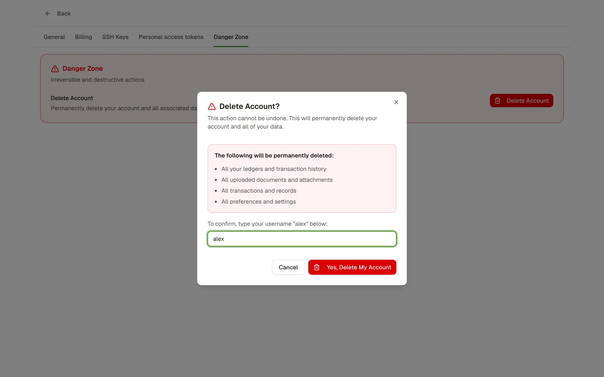

### 14. How do I connect a coding agent?

Point the MCP client at `https://<your dashboard address>/api-gateway/mcp`. In Claude Code, `claude mcp add --transport http beancount https://<your dashboard address>/api-gateway/mcp`, then sign in from `/mcp`; the consent page it opens is your deployment's. A client that takes a header can instead send a personal access token from Settings → Personal access tokens as `Authorization: Bearer <token>`. The [MCP docs](../../backend-cluster/backend-v2/docs/mcp.md) have notes for each client.

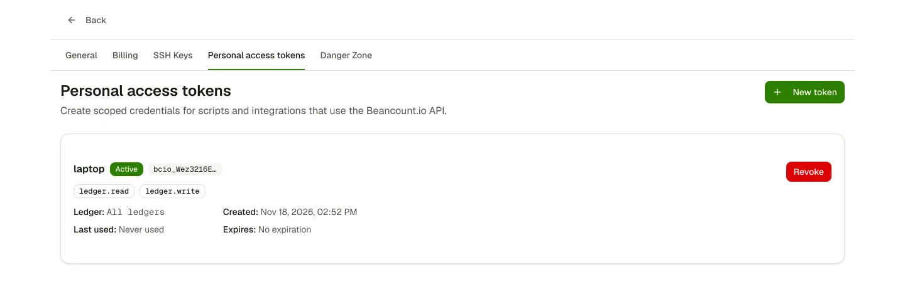

On 2026-11-18 a client with a personal access token listed the tools and ran queries on a bex deployment at this address. On 2026-11-19 the official MCP TypeScript SDK (1.32.2, the OAuth client Claude Code builds on) signed in through OAuth on a bex deployment: it registered itself, the deployment's own pages signed the user in and asked which ledger to allow, and with the token it received, refresh token included, it listed 47 tools and ran a query. A stack built before 2026-11-18 serves MCP at this address only after its dashboard is deployed again (question 9).

### 15. Can I bring my existing books, and can I leave?

To bring a ledger in, create one in the dashboard, then merge your files or Git history into it and push, signed in by `bea cloud git setup` (question 4) or with a personal access token that has `ledger.write`. The ledger reads `main.bean`, so make that your main file or have it `include` yours. These are the steps of a restore ([Back up and restore](../../deploy/bex/README.md#back-up-and-restore)): a forced push is refused, so the history goes in as a merge. From the hosted beancount.io, clone each ledger there and push it here the same way; accounts, API keys, settings and uploaded receipts do not move. On 2026-11-18 a 6,600-line ledger with its own history went into a new ledger on bex this way and checked with no errors.

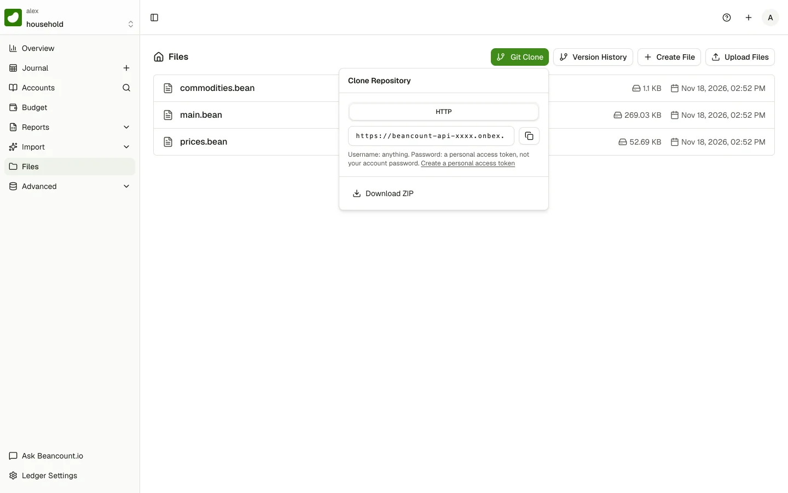

To leave, clone each ledger (question 11): every file and its history, readable by Beancount, Fava and `bea` without us. Deleting the resources in bex deletes the disk and the database for good, so clone first.

### 16. Who runs the machines, and who can reach my data?

bex does. Your services, disk and database run on bex's infrastructure, in your workspace and on your bill, the way any cloud host runs your servers. bex and Beancount.io come from the same company, Stargately, Inc., but the Beancount.io service is not part of your stack: nothing flows to it (question 12), and it holds none of your stack's secrets, which are generated inside your workspace. bex's [privacy policy](https://bex.co/privacy-policy) and [terms](https://bex.co/terms-of-service) govern the hosting. This FAQ does not yet say where the machines are, whether disks and database backups are encrypted at rest, or which bex staff can reach them. If you need those answers first, run the [Docker target](../../deploy/docker/README.md) on a server you control.

Accounts that sign in with a password have no second factor. To require one, sign in through your own identity provider (question 3) and turn it on there.

### 17. Why this, and not the hosted service or Fava on my laptop?

- **The hosted service at beancount.io:** nothing to run, and mail and AI are already set up. Your books live on our service, under its plans.
- **Fava or `bea` on your own computer:** free and fully local, but tied to that computer: no phone app, no address to share, and no agent endpoint while it is off.
- **This:** the hosted product's features on your own address and bill, with no plan limits. You pay bex about 33 USD a month and look after the stack yourself.

### 18. Where do I get help, and how do I know the stack is healthy?

In the bex dashboard each service shows its state and its logs. A deploy that missed bex's readiness deadline shows as failed and needs a deploy by hand (question 2). From a checkout of the repository, `dashboard/scripts/qa/run-self-host-sign-up.mjs` checks a fresh deploy end to end in a real browser ([Check a deployment](../../deploy/bex/README.md#check-a-deployment)). Ask in [GitHub issues](https://github.com/bex-co/beancount-io/issues) or the [Telegram chat](https://t.me/beancount); there is no support agreement for self-hosted stacks.

## Internal FAQ

### Why bex first?

It is the only target with zero operator inputs, and the platform is ours to improve. The Docker target stays the choice for a single server you already run.

### What has to be true before we say "one click" without a beta caveat?

Decided by the owner on 2026-11-18: it launches as a normal release, not a beta. The outside-user quote, the answers about bex's machines, and bex retrying a failed rollout do not gate the launch. What was only unverified was run on a live bex on 2026-11-19 ([What did the fifth live run find?](#what-did-the-fifth-live-run-find)). The list below is kept as the record.

- The clone URL is the deployment's own (ADR 0029, decision 3). Built, and run on bex on 2026-11-16.
- Mail-less recovery is stated on screen and has a documented operator path (decision 4). Built, and run on bex on 2026-11-16.
- The self-host checklist passes after every deploy (decision 6). The smoke script passes on bex with 15 checks, including closed sign-up, clone addresses on the stack, and the OAuth sign-in the mobile app uses. Mail-less recovery and the absence of beancount.io addresses are still checked by hand.
- A documented backup and restore for the bex deployment exists. Done for ledgers on 2026-11-16 and for the database on 2026-11-19 (`deploy/bex/README.md`, each run on a live stack).
- bex retries a failed rollout, or the README keeps the caveat.
- The closing of sign-up, the private Gitea and `bea ask` with `OPENAI_API_KEY` have been run on a live bex. Done on 2026-11-16; `bea ask` only as far as its configuration error, with no model key set.
- A `bea` release newer than 0.3.1, so the clone refusal reads as written in question 4. Done: 0.4.0 on PyPI and Homebrew on 2026-11-17 gives the refusal, and 0.4.1 adds the HTTPS explanation decided that day.
- `bea cloud git setup` in a released `bea`, run on a live bex, so question 4 reads as written. Not done: built on 2026-11-18 (`cli/docs/USAGE.md`, "Cloud: Git sign-in on a self-hosted server"), with the release and the live run still to do.
- At least three people outside the team deploy from the button with no help from us, and one of them is quoted, with permission, in the press release. Not done: every run so far was ours, so the press release has no quote yet.
- Question 16 says where bex runs the stack, whether disks and database backups are encrypted at rest, and who at bex can reach them. Not done.
- There is a way to add a second account, or the copy keeps saying one account per deployment. Decided on 2026-11-17: sign-up takes one account per deployment, and more wait for user feedback. Since 2026-11-18 an operator's OpenID Connect provider adds accounts for the emails `OIDC_ALLOWED_EMAILS` lists, and none without it (#198, #199, #209); question 3 says so, and the fifth run exercised it on bex on 2026-11-19.

### How will we know it worked?

The stack reports nothing to us, by design, so the measures come from outside it: the number of Blueprints bex creates from this repository and how many reach a live dashboard, how many of those stacks are still running after a month, and GitHub issues and Telegram questions about self-hosting. A rising count of stacks deleted within a day would say the first half hour loses people.

### What did the live run find?

Sign-up, tier, discovery documents, CLI access and the configuration errors worked. The clone URL, the false "Email sent!", the hosted-service welcome mail and the missing mail-less recovery did not; all four have since been changed in code. See the Evidence and Findings sections of [ADR 0029](../adrs/ADR029-deploy-self-hosting-contract.md).

### What did the second live run find?

On 2026-11-16 the Blueprint went from creation to all four services live in 27 minutes. bex accepted Gitea as a private service with a disk, and gave the API its own address, so every ledger's `httpUrl` was `https://<API address>/git/<owner>/<ledger>.git`, with `sshUrl: null`.

| Check | Result |
| --- | --- |
| Sign-up | The first sign-up signs in with no verification step. A second `signUp` answers `FORBIDDEN` ("Sign-up is closed on this server"), the sign-in page offers no "Sign up", and `/auth/sign-up` goes to sign-in. Deleting the only account reopens it. |
| Git over HTTPS | No credential and a wrong password are refused. With a personal access token as the password, `git clone` works, and so do a small push and a 20 MB push. |
| Data on the disk | The pushed commits were still there after a restart of Gitea and after a rebuild and redeploy of it. |
| Mail-less recovery | The forgot-password page says the server cannot send email. `POST /api/admin/password-reset-link` returned a link on the dashboard's address; setting a password there worked, and the link was refused the second time. |
| Admin API | A wrong token gets 401. The dashboard address answers 404 for `/api/admin/*`. |
| Configuration errors | Category suggestions answer 503 `CONFIGURATION_ERROR` with a hint naming `ANTHROPIC_API_KEY` or `OPENAI_API_KEY`; the upload URL and `bea ask`'s model proxy answer the same code, naming their own variables. |
| beancount.io on the stack | The API's log holds no `open_ledger` warning and no failed welcome mail after sign-ups and sign-ins. Settings → Billing shows no link to beancount.io. |
| CLI | `bea cloud status` reports `ENTERPRISE` and `bea cloud ledger list` works, with a token in `BEA_TOKEN`. |
| Smoke script | `run-self-host-sign-up.mjs --require-self-host` passes all ten checks and deletes its account. |

It also found two defects, both fixed and rerun the same day: Settings → Billing listed the managed service's paid plans with "Downgrade" buttons, and the smoke script looked for a button the create-ledger form no longer has, so it stopped without deleting its account, which closed sign-up on the stack.

### What did the third live run find?

Later on 2026-11-16 a second stack was created from the Blueprint as it stood before Gitea became a private service, given an account and a ledger with history, and then upgraded to `main`.

| Check | Result |
| --- | --- |
| Upgrading an existing deployment | bex refuses to change Gitea from a web service to a private one in place: the sync stops with "a service's type cannot be changed after it is created". The API had already been updated, and the stack kept working with the old public Gitea and all its data. Finishing the upgrade means deleting the Gitea service, which deletes its disk, and syncing again. |
| Backup and restore | `git clone --mirror` before the upgrade, then, on the new empty Gitea, a ledger of the same name with the backup merged in and pushed. The restored ledger opened in the dashboard with the backup's files and every earlier commit. A forced push is refused, so the restore is a merge. The steps are in `deploy/bex/README.md`. |
| `bea cloud login` | The terminal printed a one-time code, the dashboard's device page showed the requesting device and authorized it, and the stored credential then worked for `bea cloud status` and `bea cloud ledger list`. |
| Mobile sign-in protocol | Replayed from a desktop browser with the app's client and redirect: consent, redirect to `io.beancount.ios:/oauth/callback`, token exchange, a ledger read and a refresh all worked. |
| Blocked account | Sign-in answers "User is banned. If you need help, please contact the person who runs this server."; `POST /api/admin/unblock-user` restores access. |
| Large push | A 200 MB file pushed through the API's Git proxy in 84 seconds. |
| Smoke script | Now 15 checks, adding closed sign-up, clone addresses on this stack, and the OAuth sign-in; all pass. |

It found three defects, all fixed and rerun on that stack:

- After the Gitea service was deleted and created again, every ledger page answered "Page not found". The new service generates a new administrator password, but the administrator account lives in the shared Postgres and kept the old one. Gitea's start script now gives the existing account the new password.
- No OAuth sign-in could start on a bex deployment. The dashboard's same-origin API proxy followed the authorization endpoint's redirect itself, so the browser was left on a "Page not found". This stopped the mobile app's sign-in and an MCP client's authorization; the proxy now hands the redirect to the browser.
- The mobile and identity consent pages still offered "Sign Up" on a stack that had closed sign-up. They now read the same answer as the sign-in page.

### What did the fourth live run find?

On 2026-11-18 a new stack was created from the Blueprint (`main` at `0a90302df`) and used the way this document tells a customer to. It took 30 minutes from creation to a working sign-up.

| Check | Result |
| --- | --- |
| Someone signs up first (question 13) | A stranger's sign-up closed sign-up. `GET /api/admin/recent-users` showed the address, `POST /api/admin/login-as` signed the operator in as that account, Settings → Danger Zone → Delete Account removed it, and sign-up opened again for the owner. |
| `bea cloud login` | With `bea` 0.4.1 from PyPI, the device page showed the client, device and address; after **Authorize**, `bea cloud status` (`ENTERPRISE`) and `bea cloud ledger list` worked. |
| Clone | `bea cloud ledger clone` printed the HTTPS command and the token advice; `git clone` with a personal access token worked. |
| Bringing books in (question 15) | A 6,600-line ledger with its own history was merged into a new ledger and pushed, and a forced push was refused. With `main.bean` including it, `checkLedger` over MCP reported no errors and 1,051 transactions. |
| MCP (question 14) | An MCP client with a personal access token, pointed at `https://<dashboard address>/api-gateway/mcp`, listed 47 tools and ran a BQL query and `checkLedger`, after the fix below. Without a token the endpoint answers 401 with a challenge whose resource metadata, OAuth discovery and authorization redirect all name the dashboard's address. |
| First ledger | The first-ledger form offers a sample ledger. Overview, income statement, balance sheet, journal, files and the clone menu (the API's own HTTPS address) all rendered it. |

It found:

- Defect, fixed: an MCP client pointed at the dashboard's address got 406, because the dashboard's same-origin proxy dropped the `Accept` header the MCP endpoint requires; the API's own address worked. The proxy forwards it since `321d2b16f`. A stack built before that needs its dashboard deployed again.
- The settings page is "Personal access tokens", but `bea` 0.4.1 and these documents said "API keys". The documents are corrected, and `bea`'s message is corrected for its next release.
- The sign-up and sign-in pages of a self-hosted stack showed the hosted service's panel ("Join thousands of satisfied users…", "enterprise-grade security"), the Delete Account dialog said it removes your data "from our servers", and the sign-up form asked for at least 8 characters where the sign-in form said 6. Since `5ed926c92` and `a72752a2c` a self-hosted stack's panel says who runs it and that the books are plain text in Git, the dialog says only that the account and its data are deleted, and sign-in neither sets nor states a length floor. A stack built before that needs its dashboard deployed again.

### What did the fifth live run find?

On 2026-11-19 a new stack was created from the Blueprint (`main` at `ee5307632`) to run what the earlier runs had left unverified. It took 27 minutes to a working sign-up. Every resource, including a test identity provider and a restored database, was deleted afterwards.

| Check | Result |
| --- | --- |
| More accounts (question 3) | A test OpenID Connect provider on bex, with `OIDC_ALLOWED_EMAILS` naming one address and sign-up closed: that address got an account and a default ledger at its first sign-in; an address off the list was told it isn't allowed to sign in here and got no account. |
| MCP through OAuth (question 14) | The MCP TypeScript SDK 1.32.2 registered a client, signed the owner in on the deployment's pages, asked which ledger to allow, exchanged the code for a token with a refresh token, listed 47 tools and ran `runBqlQuery`. |
| Mobile app (question 5) | The iOS app on the simulator took the dashboard's address, passed its connection test, signed in through the provider above on the deployment's own pages, and showed the account's ledger. |
| Restoring the database (question 11) | After a token was revoked and another created, bex restored the database as it was before into a new one; with the API and Gitea suspended, `pg_dump` and `pg_restore` copied it back. The revoked token cloned a ledger and answered MCP again, the newer one was gone, and password sign-in and the ledgers were unchanged. |

It found:

- Not fixed, small: an MCP client that requests no scope (SDK 1.20.2 does, when the challenge names none) reaches a consent page whose **Approve access** returns `access_denied`. Current clients read the scopes from the resource metadata and are unaffected. Naming the scopes in the 401 challenge would let older clients through.
- Not fixed: the mobile app's welcome screen offers **Sign Up** on a server whose sign-up is closed; the web pages no longer do.
- Not fixed: the Blueprint's database is reachable from any address (bex's default allow-list is `0.0.0.0/0`), guarded by its generated password and TLS. The Key Value store is private.
- bex, not this repository: the connection details bex shows for a restored database name a database (`app`) and a user that cannot read the restored data, its public certificate failed to issue, and its external address timed out on many connection attempts. [The database](../../deploy/bex/README.md#the-database) works around the first two; retries got through the third.

### What is not verified?

The Android app, and either app on a physical phone; Claude Code itself (its OAuth client was run through the SDK it builds on); a custom domain, Plaid, mail delivery with a real key, and any AI feature with a real model key.
