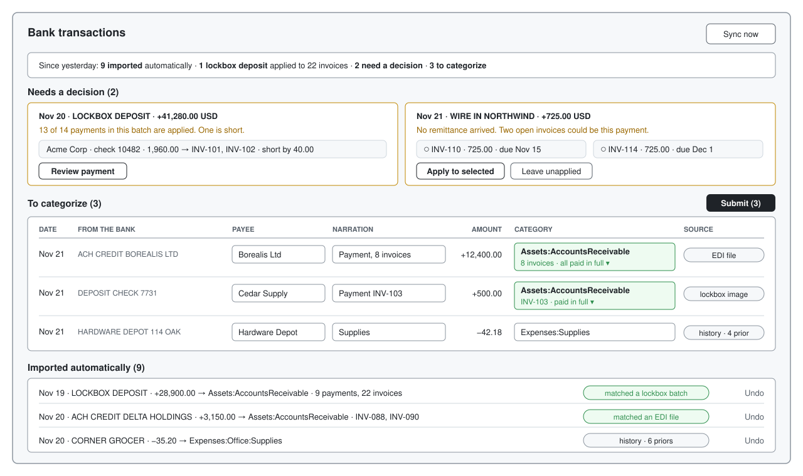
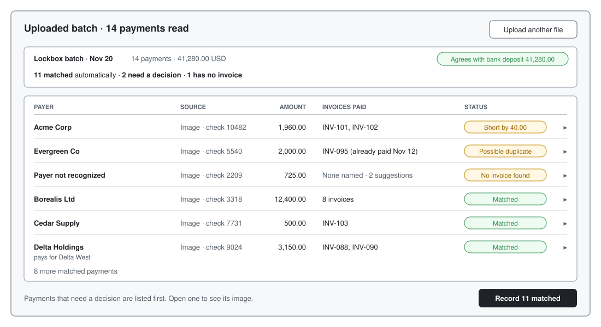
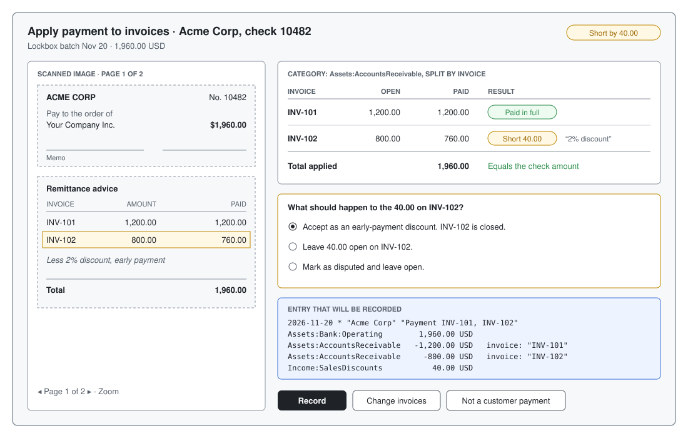

# PRFAQ007 — Customer payments: from a bank deposit to paid invoices, using lockbox images and EDI files

Status: Draft. Nothing here is built. It is the target experience, written for discussion with a customer who issues invoices and receives payments through a bank lockbox and EDI remittance files, and asked to "find the invoices that were paid".

Date: 2026-11-23

Scope: the receiving side only. A business has open invoices, money arrives at the bank, and the remittance (a scanned check and stub from the lockbox, or an EDI file) says which invoices it pays. Paying suppliers, sending invoices and the sync to an ERP are out of scope.

Relation to other records: this extends the bank import and document matching of [ADR 028](../adrs/ADR028-backend-v2-plaid-auto-import-and-receipt-matching.md), which is itself a Draft. The import, the review page and "whichever arrives first is recorded, the other is matched to it" are the same. What differs is what the transaction is booked to: a purchase goes to an expense account; a customer payment goes to Accounts Receivable, split by invoice. The ledger shape for invoices and payments is the one the [`beancount-invoices`](../../skills/beancount-invoices/SKILL.md) skill already writes for local ledgers. No ADR exists for this yet.

Not verified: the lockbox and EDI file formats a given bank sends, and how well remittance images read. Receipt parsing was tried on one receipt only, where long reference numbers were the weak spot.

## Press release

*Proposed launch copy. This is not a current product announcement.*

**Beancount.io turns a bank deposit into paid invoices, using the lockbox images and EDI files you already receive**

A deposit on the bank statement says only "LOCKBOX DEPOSIT 41,280.00". Which invoices it pays is on the remittance: a stub scanned by the lockbox, or lines in an EDI file. Today someone reads each one and keys the result in. One check can pay thirty invoices, and customers short-pay, take discounts, or quote the wrong invoice number.

From today, customer payments go through the same bank import as everything else:

- **The deposit arrives by itself.** It is imported from the bank like any other transaction.
- **The remittance tells where it goes.** You upload lockbox images or an EDI file the same way you add a receipt. Beancount.io reads payer, amount and invoice numbers.
- **The category is your invoices.** Where a purchase is booked to an expense account, a customer payment is booked to Accounts Receivable, split by invoice.
- **Either can arrive first.** Deposit first or remittance first, they are paired when the second one shows up.
- **Unclear cases are asked, not guessed.** Short payments, payments with no remittance and possible duplicates wait for your decision.

## What changes compared with a purchase

| | A purchase (ADR 028) | A customer payment |
| --- | --- | --- |
| Bank transaction | Money out | Money in |
| Document | Receipt | Remittance: lockbox image or EDI file |
| Category | An expense account, for example `Expenses:Supplies` | `Assets:AccountsReceivable`, split by invoice |
| Where the category comes from | History with that merchant, or AI | The invoice numbers on the remittance, checked against open invoices |
| Bank transaction to documents | One to one | One deposit can cover many checks, and each check many invoices |
| Can it be booked without the document? | Yes; the receipt is proof | Not to an invoice; the bank text does not name one |

## User journeys

### Journey 1: A day of deposits

The owner opens the Bank transactions page and sees customer payments beside the other transactions.

- **Imported automatically.** A deposit whose remittance names open invoices with matching amounts is booked to Accounts Receivable and those invoices are marked paid. A lockbox deposit is checked against the total of its batch.
- **To categorize.** The same list as for purchases. For a deposit, the category cell shows Accounts Receivable and the invoices found, and opens to change them. The expense in the third row is unchanged.
- **Needs a decision.** A batch with one short payment, or a deposit with no remittance where two open invoices fit. **Review payment** opens Journey 3.

### Journey 2: Upload remittances

The owner uploads on the page that takes receipts today (`/ledger/<owner>/<name>/receipt`). What follows depends on what the file holds.

- **One image, one payment:** it is read and opens directly in the review of Journey 3.
- **A lockbox batch or an EDI file, many payments:** the batch list below comes first. Payments whose invoices and amounts agree are recorded together with **Record matched**; the others open one by one in Journey 3.

### Journey 3: Apply one payment to invoices

One screen, two ways in. They are the two orders of arrival.

| Way in | When | What is already there |
| --- | --- | --- |
| Upload on the receipt page (Journey 2) | The owner holds a lockbox image or EDI file | The remittance; the bank deposit may or may not have arrived |
| **Review payment** on Bank transactions (Journey 1) | A deposit was imported and could not be applied, or is short | The bank deposit; the remittance may or may not have arrived |

1. The left side shows the check and remittance stub as scanned. The right side shows the category, Accounts Receivable, split into one line per invoice.
2. Anything that does not agree is marked: here 760.00 was paid against an 800.00 invoice, with "2% discount" written on the stub.
3. The owner chooses what happens to the difference: accept it as a discount, leave it open, or mark it disputed.
4. The entry that will be recorded is shown before **Record**.

Coming from Bank transactions with no remittance uploaded, the left side is empty and offers an upload; the right side lists open invoices of that payer with the same amount as suggestions. Coming from an upload before the deposit has arrived, the bank side reads "waiting for the deposit" and is completed when it is imported.

A payment whose invoice numbers and amounts all agree never reaches this screen. It is recorded automatically and listed under Imported automatically with an Undo.

This is the review step of today's receipt page with one field changed: where the receipt form asks for one expense account, this asks for Accounts Receivable split by invoice, and adds the short-payment choice and the scanned image beside the form.

## How a payment is matched

A payment is booked automatically only when every line names an open invoice and the amounts agree. Everything else is suggested and waits for the owner.

| Situation | What Beancount.io does |
| --- | --- |
| Invoice numbers and amounts agree | Books to Accounts Receivable and marks the invoices paid |
| One payment covers many invoices | Splits it line by line |
| Paid less than the invoice | Suggests the invoice and asks what to do with the difference |
| Paid more, or the invoice is already paid | Flags an overpayment or duplicate and asks |
| No remittance, or a wrong invoice number | Suggests open invoices of that payer with the same amount |
| Payer differs from the customer (a parent company pays) | Asks once, then remembers who pays for whom |
| Remittance arrives before the deposit | Records the payment against the invoices; the deposit completes it |
| Nothing fits | Leaves the deposit unapplied until the owner assigns it |

## Customer FAQ

### 1. Do I need to connect my bank?

It is the main path: the deposit is the proof that the money arrived, and it lets a lockbox batch total be checked. Without it, remittances can still be applied to invoices, without that check.

### 2. Where do my invoices come from?

They must be in Beancount.io as open receivables. For a demo they are loaded from a file (number, customer, amount, due date). A live connection to an ERP is a later step.

### 3. Which files can it read?

Scanned images and PDFs of checks and remittance stubs, and EDI remittance files. The exact formats depend on the bank; they will be built against sample files.

### 4. How accurate is reading from an image?

Printed stubs should read well; handwriting and long invoice numbers are the weak spot. A number read from an image must also agree with an open invoice and its amount before anything is booked automatically, and the image is always shown beside the result.

### 5. What goes back to my ERP?

For each payment: the invoices it paid, the amount applied to each, any discount or open remainder, and a link to the image. Format and timing are agreed separately.

### 6. Can I undo it?

Yes. Undoing a payment reopens its invoices.

## Open questions

1. Is one upload entrance right, with the system telling a receipt from a remittance, or should remittances have their own? One entrance fits "the owner does not have to say what arrived", but the page is named Receipt today.
2. How is a lockbox deposit recorded: one entry with the deposit and every invoice line, or one entry per payment against the single bank transaction? The wireframe shows one payment's entry and does not settle this.
3. Which account takes an accepted discount? The wireframe uses `Income:SalesDiscounts` as a placeholder.
4. Must the invoices live in the ledger, or can open invoices be read from an ERP and only the result written back?
5. Which lockbox and EDI formats to support first. This needs the customer's sample files.
6. Whether a fully automatic mode for trusted payers belongs in the first version.

## What we need from the customer

- A sample lockbox batch (images plus any data file) and a sample EDI file, with customer details removed if needed.
- An export of open invoices for the same period.
- Whether the bank account that receives lockbox deposits can be connected, and which bank it is.
- How lockbox files arrive today: bank portal download, SFTP, or email.
- Rough volume: payments per day, and invoices per payment.
- How short payments and discounts are handled today, and who decides.
- Which system should receive the result.
